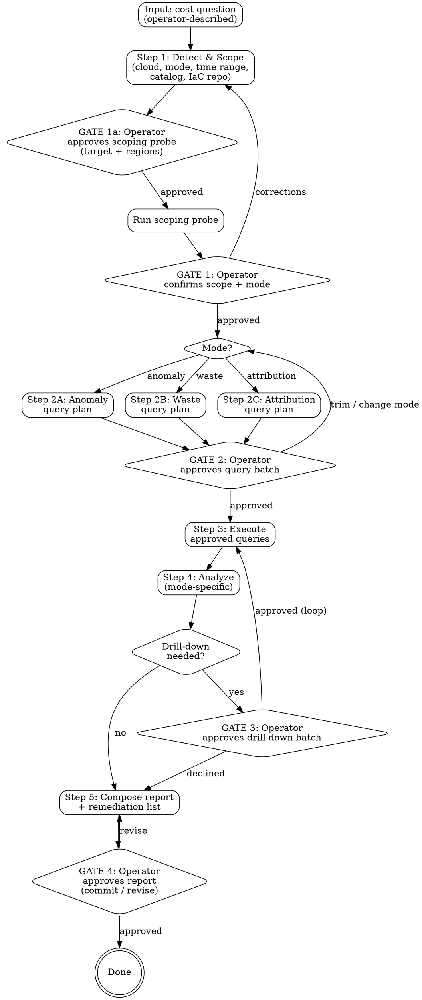

# Cloud Cost Investigate

Given a cost question, run a read-only investigation in one of three modes — **anomaly** (why did the bill change), **waste** (what are we wasting), or **attribution** (what does X cost) — and produce a report with findings and a prioritized remediation list. Strict read-only Iron Law; per-batch operator approval for queries; cloud-native APIs only.

## The Iron Law

```
NO MUTATIONS. EVER.
NO QUERY BATCH WITHOUT OPERATOR APPROVAL.
NO SAVINGS CLAIM WITHOUT A LABELLED SOURCE.
```

- Law 1: Strictly read-only. Cost APIs, resource-state APIs, metrics APIs only. No `delete`, `terminate`, `update`, `purchase` — not even "harmless" tagging fixes.
- Law 2: Every batch of cloud queries is shown to the operator and approved before execution. Per-batch (not per-query) to keep friction reasonable, but the batch is itemized with API costs and IAM permissions called out.
- Law 3: Every dollar figure in the remediation list is tagged with its source (`compute-optimizer` / `line-item-computation` / `allocation-model`), its rate basis for computed rows (`bill-derived` / `list-price`), and confidence (`high` / `medium` / `low`). Every row's evidence cites the query that produced it (`live:<query #>`), or `code:<path:line>` when an IaC repo was given, or `UNVERIFIED`. No bare "save $X" claims. Evidence classes: `live:<query #>`, `code:<path:line>`, `docs: <URL>` (official AWS / Kubernetes / OpenCost / Kubecost documentation read in this session, with the date) for any claim about how billing, pricing or the platform *behaves* — how a commitment applies, when tag data starts, what an autoscaler removes — `operator-stated`, `UNVERIFIED`. Behaviour recalled from memory is not evidence. `UNVERIFIED` and `operator-stated` cap a row at `confidence: low` and cannot support a delete, a resize or an `expected` verdict. `high` needs all four: a `bill-derived` rate, `live:` activity or event evidence, the Principle 3 window met, and `Realizable` known. `medium` is the same evidence with a `list-price` or `allocation-model` rate. Everything else is `low`.
- **Source order.** Prefer what the installed tool reports for this target (`plan:` / `live:`: `terraform plan`, `terraform providers schema -json`, `kubectl explain`, the CLI's own help), because it matches the versions in use. Next is official documentation for the version in use (provider lock file, chart version, cluster version), read in this session and cited as `docs: <URL>` with the date and the sentence relied on. Recall comes last: it may say where to look, but it is `UNVERIFIED` and never decides a driver verdict, a confidence label or a savings figure. Look things up only for claims that drive a decision; keep the URL, date and quote, not the page.

## Guiding principles

Four principles govern how waste evidence is read and how savings are claimed. They sit above the per-mode query plans — apply them when designing the batch, when scoring confidence, and when labelling savings.

### Principle 1 — Verify activity, not attachment

Evidence of no-use measures **activity**, never **attachment**. These are different dimensions and must never be conflated:

- **Activity:** observed throughput — request / invocation / transaction counts, read or processing volume, access-log hits, query counts over a representative window.
- **Attachment:** a consumer, reference, policy, route, binding, or dependent configured against the resource. Attachment answers "what breaks if I remove this," NOT "is this being used."

Rules:
1. A dependent being enabled / connected / configured / attached is **not** evidence of use. Declared config ≠ runtime behavior. Confirm with an activity metric over a representative window.
2. The inverse holds: a resource being un-attached is **not** automatic evidence of no-use unless the resource type has no activity dimension (e.g., unattached EBS volume, unallocated Elastic IP — these cost money regardless). For anything with a usage signal (DB, queue, stream, bucket, function), require activity data.
3. **Discount keep-alive noise.** Heartbeats, health checks, warm-up schedules, monitoring probes, liveness pings, and automatic retries all produce activity that masks idleness. Their tell is a uniform, periodic, workload-independent cadence. Identify and subtract synthetic traffic before judging a resource idle.
4. Candidates whose only evidence is attachment state (or absence of it, for a resource type with an activity dimension) are capped at `confidence: low` and labelled `activity-unverified` in the report.
5. **Two independent signals for a delete.** A delete requires BOTH signals: activity = none (throughput) AND attachment understood (dependency map). Neither substitutes for the other — "nothing attached" is not enough (it may be reachable by a path not yet mapped), and "zero throughput" is not enough (removing it can still break a wired-but-idle consumer). Produce both before recommending a delete.

**Rationalization stopper:** "Something is attached / enabled, so it's in use" — and the inverse "nothing's attached, so it's waste" — both STOP. Attachment ≠ activity for any resource with a usage signal. Verify actual throughput.

### Principle 2 — Verify the cost-change direction before claiming a saving

Every savings claim involving a pricing-mode or tier change must compute the delta from **real pricing × the resource's actual utilization profile**, not from the direction of the switch. Usage-based / elastic / on-demand pricing carries a per-unit premium that can *exceed* a small fixed / reserved footprint at low utilization. The cheaper mode flips with the shape of the workload.

This applies whether the candidate came from Compute Optimizer or from line-item computation. Compute Optimizer output starts at `confidence: low`, reaches `medium` once the ≥ 30d hourly check and the RI/SP coverage check (Principle 4) pass, and is never promoted to `high` without a utilization-anchored computation.

**Model the transition, not just the endpoints.** A pricing-mode or tier change can *raise* cost during the transition before the new steady state pays off — a Kinesis stream switched on-demand → provisioned inherits a high shard count and costs more until the count is stepped down. Savings estimates for mode / tier changes must show the path (interim cost and time-to-payback), not only the start and end states.

**Rationalization stopper:** "Switching mode / tier will be cheaper" → STOP. Compute the delta from real pricing × real utilization first; the premium may run the other way.

### Principle 3 — Scale the verification window to the action's destructiveness

Evidence must be read over a window sized to how destructive the proposed action is. A window that is adequate for a resize is far too short to justify a delete.

- **idle → resize / downgrade:** require ≥ 30 days of utilization data.
- **idle → delete / decommission:** require 60–180 days.
- Read at **hourly granularity**, not daily aggregate — a daily average hides bursts and idle stretches alike. (CloudWatch returns at most 1,440 datapoints per call: at 1-hour periods, split windows longer than 60 days into ≤ 60-day calls.)
- **An empty result is not zero.** `Datapoints: []` is what CloudWatch returns for a wrong account, region, namespace or dimension — not an error. Confirm the metric exists (`cloudwatch list-metrics` with the same namespace + dimensions) before reading an empty series as "no activity"; otherwise the row is `UNVERIFIED`.
- **Measure the window from the right event.** "Unused for N days" counts from when use stopped (detach, last invocation, last write) — never from `CreateTime`.
- Inspect the **temporal distribution** of activity, not just the total. A single historical burst is not steady low use: a stream with 48 requests all inside one 2-hour window 3.5 months ago is idle now, not lightly used.

A delete-candidate whose only evidence comes from a window shorter than 60 days is capped at `confidence: low` and labelled `window-too-short`.

**Rationalization stopper:** "It read 0 over the default window — delete it" → STOP. The default window is sized for resize, not delete. Pull 60–180d at hourly granularity and read the distribution before recommending a delete.

### Principle 4 — Cost from the bill, attribute to the metered dimension

Every cost and savings figure must be derived from what is actually billed, and attributed to the dimension that is actually metered.

- **Bill-derived rates first.** Compute the effective $/unit from the real bill (usage quantity ÷ line-item cost) rather than list price. Label such figures `bill-derived`; list price is a fallback, labelled as such.
- **Attribute to the metered dimension, not the trigger.** Resolve every dollar to what is billed. A schedule, rule, or event source that is itself $0 is not the cost — "$X EventBridge schedule cost" is a misattribution when 100% of the charge is the target Lambda's GB-seconds.
- **Recurring vs residual.** Classify each charge as recurring or residual / one-off / self-clearing. A leftover line from an already-deleted resource (e.g. an extended-support charge for an instance that no longer exists) clears itself and is not a saving to chase.
- **Realizable, not list.** A Reserved Instance / Savings Plan is paid either way, and a Savings Plan's hourly benefit goes to the eligible usage that earns the most savings and is not carried to the next hour (`docs: https://repost.aws/knowledge-center/savings-plans-billing`). So removing covered usage saves ~$0 only when no other eligible on-demand usage can absorb the freed commitment; otherwise the saving lands elsewhere at another rate. Every rightsize / delete row on RI/SP-eligible services carries one of three states: `yes` (coverage fetched, none for that service / family / region), `covered until <date>` (any coverage — excluded from totals, owner decision), `unknown` (coverage not fetched — excluded from totals, `UNVERIFIED`). Coverage is read per service / family / region, never per instance. Compute Optimizer prices at on-demand unless its savings-estimation mode includes discounts — treat its figure as list.
- **Incremental storage is not its nominal size.** EBS snapshots are incremental: deleting one frees only blocks no other snapshot references. Never price a snapshot as `VolumeSize × rate`; use the bill (snapshot usage by ID/tag) or mark the figure `low`.
- **Kubernetes allocation is a model, not the bill.** OpenCost / Kubecost dollars are allocated from list or custom prices unless cloud billing integration is configured; label them `allocation-model`. On EKS the same spend also appears as EC2 in the AWS bill — never sum the two. A rightsize-requests saving also does not reach the bill until nodes go away: the row is `Realizable: conditional on node reduction` (excluded from totals) unless node-level slack and a removal path — an autoscaler / consolidation policy or a planned nodegroup resize — are evidenced (`live:` + `docs: https://karpenter.sh/docs/concepts/disruption/` or the installed autoscaler's docs). HPA targets are a percentage of requests, so lowering requests changes scaling (`docs: https://kubernetes.io/docs/tasks/run-application/horizontal-pod-autoscale/`).

**Rationalization stopper:** "List price says $X, and the schedule that triggers it is the cost" → STOP. Derive the rate from the bill, and attribute it to the metered dimension.

## Constraints (Non-Negotiable)

1. **Read-only.** No mutations of any kind. Not even tagging fixes, even if they would "improve future investigations".
2. **Per-batch query approval.** No queries run before GATE 1a (scoping probe), GATE 2 (initial batch) or GATE 3 (drill-down batch) approval. Skill never silently extends a batch.
3. **API costs and IAM in the plan.** Every query plan itemizes IAM permissions and (where applicable) API per-request costs. Cost Explorer bills **every paginated page** as a request — estimate pages, not calls. Operators must not be surprised by an unexpected bill from Cost Explorer queries.
4. **Single account by default — enforced, not assumed.** In an AWS Organizations management (payer) account, unfiltered Cost Explorer returns the whole organization. Single-account scope there means a `LINKED_ACCOUNT` filter on **every** CE call. Org-wide is opt-in and triggers a stricter scope confirmation. Skill never escalates from single to org silently.
5. **Regions covered are stated, never implied.** Resource-state, Compute Optimizer and CloudWatch calls are regional; Cost Explorer is global. Sweeps run in every region that carries spend in the window (Step 1.4); the report header lists `Regions covered:`. A sweep never run in a region is a gap, not "no waste".
6. **Catalog-or-tag for attribution mode.** Attribution mode refuses to run without either a service-discovery catalog or an operator-confirmed tag convention.
7. **Source-labelled, evidence-cited savings claims.** Every dollar figure in the remediation list carries `source`, rate basis, `confidence` and an evidence reference (Law 3). Informational and excluded items (untagged spend, residual charges, binding-constraint exclusions) go to their own report section — never the remediation table, which downstream skills parse as actions.
8. **Cloud-native APIs only in v1.** No third-party FinOps tools beyond in-cluster OpenCost / Kubecost. No warehouse/billing-export (CUR / Data Exports) queries. Deferred to v2 via the `examples/` extension pattern.
9. **All output in `.culiops/cloud-cost-investigate/`.** Single directory, single file per investigation, named `<scope-slug>-<mode>-<YYYYMMDD-HHmm>.md` (service name in attribution mode; slugified account or cluster identifier — alias preferred, ID acceptable — in anomaly and waste modes). Same convention as other skills.
10. **No raw output in the report.** Raw query output stays in the session. The report holds results the skill extracted (IDs, sizes, sums, timestamps) plus a per-query status table. Never write environment-variable values, secrets, tokens, kubeconfig contents, presigned URLs or user data into the report. Describe calls that can return them (`lambda list-functions` / `get-function`, `ecs describe-task-definition`, pod specs) run only with a `--query` / `jsonpath` projection that excludes them.
11. **Stop on query failure.** Auth errors, rate limits, service unavailability halt the investigation and surface to the operator. The skill does not silently skip and produce a partial report disguised as complete.
12. **No auto-remediation handoff.** Even if a remediation fits perfectly into `iac-change-execution`, the skill stops at the report. Operator triggers the next skill explicitly.
13. **Supported owners only for remediation.** Cost from resources owned by CloudFormation / Serverless / SAM / CDK (tag `aws:cloudformation:stack-name`) is reported, but its remediation row is marked `Owner: unsupported-owner (cloudformation)` and carries no IaC change suggestion. GCP / Azure are out of scope — if the operator's question is about them, say so and stop.

## Rationalization Prevention

| Thought | Reality |
|---------|---------|
| "This unattached volume has been sitting for a year — I'll just include a delete in the report" | STOP — read-only. Recommendation only, never an action. |
| "Cost Explorer charges are tiny, I don't need to surface them" | STOP — operators have hit unexpected bills from automated tooling. Itemize. |
| "Compute Optimizer says save $400 — I'll write that as the savings" | STOP — label `source: compute-optimizer, rate: list-price`; `confidence: low` until the 30d hourly + coverage checks pass, then `medium`. Don't strip the source. |
| "The catalog is missing — I'll attribute by guessing from naming pattern" | STOP — attribution mode requires catalog or operator-confirmed tag. Naming-pattern guessing produces wrong attributions. |
| "The operator already approved one batch, the next batch is similar, I'll just run it" | STOP — per-batch approval is non-negotiable. Drill-down is its own gate. |
| "Bill went from $50K to $80K — I'll declare ML team caused it because they always do" | STOP — driver claims need evidence in the queries run. No priors. |
| "Untagged resources are obviously waste — flag them" | STOP — untagged ≠ waste. Flag as "untagged spend, $X/mo, owner unknown" — operator decides. |
| "Nothing's attached / referenced — it's waste" | STOP — attachment ≠ activity. For any resource type with a usage signal (DB, queue, stream, bucket, function), require an activity-window check before claiming no-use. |
| "Health-check / heartbeat traffic shows hits — it's in use" | STOP — keep-alive noise has a uniform, periodic, workload-independent cadence. Identify and subtract synthetic traffic before judging activity. |
| "Switching from reserved to on-demand (or vice-versa) will save $X" | STOP — never assume direction. Compute delta from observed utilization × real pricing for both modes. The premium may run the other way at this utilization. |
| "CPU is only 12% — this DB can be downsized" | STOP — databases are usually memory- or connection-bound. Check freeable memory and connection count over the window before calling it downsizeable. |
| "Org-wide scope would give a better picture — I'll just go org-wide" | STOP — scope escalation requires operator opt-in. Never silent. |
| "I'll skip listing IAM permissions, the operator obviously has admin" | STOP — least-privilege is the user's expectation. Always list. |
| "This finding needs a metrics query — I'll batch it in with the original batch" | STOP — original batch is approved as-is. Drill-down is GATE 3. |
| "This snapshot is older than 30 days — it's orphaned" | STOP — age is not orphaned. Orphaned = source volume gone AND no AMI references it AND not AWS Backup / DLM managed. And it's incremental: its saving is not `VolumeSize × rate`. |
| "The volume was created 400 days ago and is unattached — unused for 400 days" | STOP — `CreateTime` is not detach time. Find the detach event (CloudTrail `DetachVolume`, ≤ 90d) or cap at `low` + `window-unverified`. |
| "CloudWatch returned no datapoints — zero traffic" | STOP — empty is what a wrong region / dimension / account returns. Confirm the metric exists first. |
| "I'm in the payer account, CE says $80K — that's this account" | STOP — unfiltered CE in a payer account is the whole org. Filter by `LINKED_ACCOUNT`. |
| "We only swept the default region, nothing found — the account is clean" | STOP — sweeps are regional. Run them where the spend is, and list regions covered. |
| "`kubectl top` shows 3% CPU — the pod is idle" | STOP — `top` is one instant. Use the allocation API's efficiency over ≥ 30d. |
| "Compute Optimizer says $280/mo — that's the saving" | STOP — check RI / Savings Plan coverage. Covered capacity saves ~$0 until the commitment ends. |
| "The bill spiked the day we bought the RI — that's the anomaly" | STOP — split `RECORD_TYPE`. Purchases, credits, refunds and tax are not usage; compare the usage record types (`Usage` + `DiscountedUsage` + `SavingsPlanCoveredUsage`) at `AmortizedCost`. Filtering `Usage` alone hides covered spend. |
| "A new instance launched the week the service rose — that's the cause" | STOP — one leg of three. Amount (units × rate), timing (the day the series steps) and a named change must each be cited. Below three legs it is `candidate` / `probable`, never "caused by". |
| "It looks like normal growth — mark it expected" | STOP — `expected` needs a cited plan or a recurring pattern. Memory of how the team usually behaves is not evidence. |
| "Pod requests are 10× usage — that's $X saved" | STOP — nodes must go away first. `Realizable: conditional on node reduction`, excluded from totals until a removal path is evidenced. |
| "I'll paste the raw output into Queries run so it's auditable" | STOP — raw output stays in the session (Constraint 10). The report records extracted results and query status. |

## Red Flags — STOP and Follow Process

| Red Flag | What to Do |
|----------|------------|
| About to call any non-`Get` / non-`Describe` / non-`List` API | STOP — read-only. The skill never calls write APIs. |
| Operator asks for a recommendation outside the report's source set | STOP — bring the question into the next investigation, don't fabricate. |
| A planned Cost Explorer query will paginate (DAILY × many groups, long window) | Estimate pages × $0.01 in the plan; prefer MONTHLY or fewer group-bys where the question allows. |
| Authenticated account is an Organizations management account | Add `LINKED_ACCOUNT` to every CE call unless the operator opted in to org-wide at GATE 1. |
| A query result would contain env vars, secrets or kubeconfig data | STOP — re-run with a projection that excludes them; never copy them into the report. |
| Catalog references resources missing from the cost lookup (attribution mode) | Flag as "untraced", do NOT silently drop from the report. |
| Cost line items with no matching catalog resource (attribution mode) | Flag as "context cost", do NOT attribute to the service. |
| Operator asks "just summarize without showing me the queries" | STOP — query plan visibility is non-negotiable. Explain why. |
| Drill-down query batch is large (>10 queries or >$1 estimated API cost) | STOP — split into smaller batches with separate gates. |
| Resource-state query returns thousands of items | STOP — narrow scope (region, tag) and re-batch rather than dump everything. |
| Recommender returns conflicting recommendations for the same resource | STOP — present both, let operator pick. Do not pick one silently. |

## Workflow

Fixed pipeline with mode-specific middle (Steps 2 and 4 branch per mode; Steps 1, 3, and 5 are shared). One branch point at Step 2.



### Step 1 — Detect & Scope (shared)

**Inputs:** Operator's cost question (freeform).

**What the skill does:**

1. **Detect cloud.** Check for authentication signals: `AWS_PROFILE` / `AWS_REGION` env vars and `~/.aws/` (AWS), `kubectl config current-context` (Kubernetes). If both are configured, list them and ask which to investigate. If none, ask the operator to authenticate. A question about GCP or Azure → out of scope (Constraint 13); say so and stop.
2. **Detect mode from question phrasing.** Heuristic: "spike / increase / why" → anomaly; "waste / unused / idle / save" → waste; "what does X cost / breakdown / per-service" → attribution. Always confirms — never auto-runs.
3. **Establish the target** — the **scoping probe** (items 3–4). Show it as a mini batch (same table shape as GATE 2: 4 read-only calls, 1 Cost Explorer request ≈ $0.01) and run it only on the operator's approval (**GATE 1a**). It is the only query run before GATE 1:
   - `sts get-caller-identity` + `iam list-account-aliases` → account ID and alias, shown at GATE 1 so the operator can catch "wrong profile".
   - `organizations describe-organization` → is this account the management (payer) account? The call works from any account in the organization (`docs: https://docs.aws.amazon.com/sdk-for-go/api/service/organizations/index.html`), so compare `MasterAccountId` with the caller: equal = payer, different = member. `AWSOrganizationsNotInUseException` = standalone. Any other error, `AccessDenied` included, leaves payer status `unverified`: treat the account as payer. Payer or unverified + single-account scope → every CE call gets a `LINKED_ACCOUNT` filter (Constraint 4); on a member or standalone account the filter changes nothing.
   - Kubernetes: the context's cluster name and API server, and whether OpenCost / Kubecost is installed (`examples/kubernetes.md`).
   Default scope is that single account / cluster. Org-wide or multi-cluster only when the operator says so.
4. **Find the regions with spend.** One CE call, `MONTHLY`, last 30d, grouped by `REGION` (global line items show as `global` / `NoRegion`). Every region above the noise floor (default 1% of spend) becomes a sweep region (Constraint 5). The operator can add or drop regions at GATE 1.
5. **Set time range.** Defaults per mode:
   - Anomaly: last 30d vs. previous 30d (or last 7d vs. previous 7d if request mentions recent), **ending 2 days ago** — the most recent CE days are estimated and still filling in. Windows are equal length; never compare a month-to-date or forecast against a full month.
   - Waste: current resource state + last 30d utilization metrics for resize candidates (Principle 3); delete / decommission candidates require a 60–180d confirmation window, fetched at the Step 3 drill-down.
   - Attribution: previous complete billing month.
   Operator can override.
6. **Look up catalog.** Check `.culiops/service-discovery/<service>.md`. Required for attribution mode unless the operator confirms a tag convention (the tag key is the team's own — list the active keys with `ce list-cost-allocation-tags --status Active`; Kubernetes: the label key the catalog names). A key must be activated as a cost-allocation tag to appear in CE, activation takes up to 48 h (`docs: https://docs.aws.amazon.com/awsaccountbilling/latest/aboutv2/activating-tags.html`), and earlier periods cannot be assumed to carry it (a backfill API exists). Check the key's `LastUpdatedDate`: a tag-filtered figure, or a trend, that spans activation is `UNVERIFIED`. Optional for the other modes.
7. **Ask for the IaC / manifest repo** (optional) — a local checkout, or a GitHub repo read through `gh`. With one, remediation rows can cite `code:<path:line>` for the resource definition, and anomaly drivers can cite the commit or merge that introduced the change; without one, ownership comes from tags and labels only. Full ownership probing is `cost-optimize-plan`'s job — this skill does not duplicate it.
8. **Present scoping summary:**

> "**Cost question:** `<freeform>`
> **Mode:** anomaly / waste / attribution (suggested from phrasing)
> **Cloud:** `<aws|kubernetes>`
> **Target:** `<account-id>` (`<alias>`) — `<payer | member | standalone | unverified (treated as payer)>`  ·  or cluster `<name>`
> **Scope:** single (say `org-wide` to expand) — `<LINKED_ACCOUNT filter applied | not needed>`
> **Regions to sweep:** `<list, with % of spend>`
> **Time range:** `<from> → <to>`
> **Catalog:** `<path or 'none — using tag convention <key>' or 'none — proceeding account-wide'>`
> **IaC repo(s):** `<path(s) or 'none — owner from tags only'>`
>
> **Confirm to proceed to query planning.**"

**GATE 1.** Operator confirms or corrects.

### Step 2 — Mode-specific query plan (branch point)

The skill generates a query batch for the chosen mode. Each query is shown with: API method, scope, **region**, time range, IAM permission required, estimated API cost (Cost Explorer: $0.01 × estimated pages — verify the current rate on the AWS Cost Explorer pricing page), and what the result will tell us. Regional queries are repeated per sweep region from Step 1.4 and shown as one row with the region list.

#### Step 2A — Anomaly mode query plan

Typical batch:
1. **Native anomaly findings (if enabled).** `ce get-anomalies` for the window — AWS Cost Anomaly Detection's own root-cause dimensions are a cheap first lead. Empty is not "no anomaly" if no monitor is configured.
2. **Usage spend by day, grouped by service**, for both comparison windows — identifies which service(s) drove the delta. "Usage" = the three usage record types `Usage`, `DiscountedUsage` (RI-covered) and `SavingsPlanCoveredUsage` (SP-covered), read at **`AmortizedCost`** so covered usage carries its effective commitment rate. Filtering `Usage` alone drops every covered line and makes a commitment expiry look like new spend. Purchases (`RIFee`, upfront `Savings Plan` fees), `Credit`, `Refund`, `Tax` and `Support` are pulled in a separate call grouped by `RECORD_TYPE`: a one-day upfront purchase or an expired credit is a bill change, not a usage anomaly. Under amortization, `SavingsPlanRecurringFee` / `RIFee` is the *unused* commitment — report it with the non-usage lines.
3. **Commitment coverage.** `ce get-savings-plans-coverage` / `ce get-reservation-coverage` over both windows, plus active commitments' end dates (`savingsplans describe-savings-plans`, `ec2 describe-reserved-instances`, `rds describe-reserved-db-instances`). A commitment expiring raises on-demand cost with **no resource change** — the new-resource sweep cannot explain it.
4. For top-delta services, drill by region / usage type / linked account / tag, with `UsageQuantity` beside the cost — it splits the delta into more units versus a higher rate for the same units (commitment expiry, tier, credit).
5. Resource-state query for newly-created resources in the anomalous window, **in the regions the drill-down names** (e.g., `ec2:DescribeInstances`). Caveats in the plan: `LaunchTime` resets on stop/start (not creation time), and instances terminated more than ~1h ago no longer appear — for those, the resource-level CE view (`get-cost-and-usage-with-resources`, `RESOURCE_ID`, last 14 days, requires opt-in in CE settings) or CloudTrail `RunInstances` (Event history, ≤ 90 days) is the source.
6. (Optional, gated separately at Step 3) Utilization metrics for top-delta resources to confirm whether they're actually being used or just running idle.
7. **Kubernetes:** a "what changed" source for anomaly drivers (new workloads, node-pool changes, GitOps revisions) is not supported yet. Report allocation deltas from `examples/kubernetes.md` only, and name no cause.

#### Step 2B — Waste mode query plan

Typical batch (regional calls run per sweep region):
1. **Compute Optimizer** rightsizing recommendations (EC2, EBS, Lambda, ECS on Fargate, Auto Scaling groups, RDS) and idle findings (`get-idle-recommendations` — a lead, not delete evidence). Pre-scored but priced at on-demand and based on a 14-day default lookback — below Principle 3's ≥ 30d for a resize. A CO row starts at `confidence: low` and is promoted to `medium` only after the Step 3 drill-down confirms it over ≥ 30d hourly and RI/SP coverage is known (Principle 4).
2. **Resource-state sweeps.** Unattached EBS volumes (state + ownership tags); snapshot **orphan candidates** (source volume no longer exists — see `examples/aws.md`; age alone is not orphaned); unassociated Elastic IPs; load balancers (`elbv2` for ALB/NLB/GWLB **and** `elb` for Classic); S3 buckets without lifecycle policies (a hygiene flag, not a saving — no $ without a storage-class analysis); NAT gateways, Lambda functions, DynamoDB tables, EKS nodegroups, Kinesis streams (inventory for the utilization step).
3. **Commitment coverage** for the services that carry rightsize / delete candidates (`ce get-savings-plans-coverage`, `ce get-reservation-coverage`) — needed for `realizable` (Principle 4).
4. **Untagged spend.** Cost grouped by tag presence — surfaces resources without service/owner/env tags.
5. **Utilization metrics** for instances / databases / queues / streams / functions — CPU, memory, network, request count, invocation count, throughput at **hourly granularity** over the Principle 3 window (≥30d for resize candidates; 60–180d for delete / decommission candidates, chunked ≤ 60d per call). **Required (not optional)** for any rightsize or idle-resource candidate per Principle 1. For **database rightsize candidates, fetch the binding constraint** — freeable memory and active connection count — not CPU alone; databases are usually memory- or connection-bound, so CPU can read low on a resource that cannot be safely downsized. Resources with no activity dimension (unattached EBS, unassociated EIP, orphan-candidate snapshots) are exempt from activity metrics — but not from the **window** rule: their "unused since" date comes from the detach / disassociate event (CloudTrail Event history, ≤ 90 days, or AWS Config history), never from `CreateTime`.

#### Step 2C — Attribution mode query plan

Typical batch:
1. **Resolve resource list.** From catalog (preferred) or tag filter (operator-confirmed key). List of resource IDs scoped to the service.
2. **Cost lookup.** Cost Explorer filtered by tag (cost-allocation tag) or linked account, grouped by usage type, for the time range — usage record types at `AmortizedCost`, so commitment-covered resources aren't silently missing. Resource-ID-level breakdown only via `get-cost-and-usage-with-resources` (last 14 days, opt-in) — say so when the window is longer.
3. **Period comparison.** Same window in the previous period — surfaces growth/shrink trends.
4. **Untraced cost check.** Resources in the catalog that did not appear in cost lookup (potentially mis-tagged or in a different account). Flag, don't fail.

#### Common batch presentation (all three modes)

> **Query plan for `<mode>` investigation:**
>
> | # | API | Scope | Region(s) | Time | IAM | Est. cost | Why |
> |---|-----|-------|-----------|------|-----|-----------|-----|
> | 1 | `ce:GetCostAndUsage` | `<acct>` (`LINKED_ACCOUNT` filter) | global | last 30d | `ce:GetCostAndUsage` | ~$0.02 (2 pages) | usage spend by service |
> | 2 | ... | ... | ... | ... | ... | ... | ... |
>
> **Total estimated API cost:** $0.0X
> **IAM permissions needed:** `<consolidated list>`
>
> **Approve this batch?** (approve / trim / change mode)

**GATE 2.** Operator approves, trims (drops specific queries), or changes mode (loops back to Step 1's mode confirmation).

### Step 3 — Execute approved queries (shared mechanics)

Run the approved batch. Raw output stays in the session for analysis; it is **never** copied into the report (Constraint 10). For each query record: number, status (`ok` / `failed` / `empty`), row count, and region. Results used as evidence are referenced as `live:<query #>`. If a query fails (auth, rate limit, service unavailable), skill stops and reports the failure — does not silently skip. An `empty` metric result counts as zero only if the `list-metrics` existence check — planned in the **same batch** as the metric query, never added afterwards — shows the metric exists (Principle 3); otherwise it is `UNVERIFIED`. Close any `kubectl port-forward` started for the batch when it finishes.

### Step 4 — Analyze (mode-specific)

#### Step 4A — Anomaly analysis

- Compute period delta totals on the usage record types at `AmortizedCost`; report the non-usage delta (purchases, credits, refunds, tax, support) as its own line.
- Check commitment coverage first: a coverage drop or an expiry inside the window is a driver in its own right, even with no resource change.
- Decompose delta by dimension: service → region / usage type / account / tag.
- Match new-resource list against top-delta services to identify likely drivers. A match on `LaunchTime` is a candidate, not proof — it may be a restart.
- **Tie test: a driver's verdict rests on three legs, each cited.** *Amount:* units × `bill-derived` rate (resource-level or usage-type cost, `live:`) explains the driver's delta. *Timing:* the daily series steps on the day of the change. *Cause:* a named change — a CloudTrail / Config event, a `code:` commit or merge in the IaC repo, or a dated commitment expiry, purchase, credit end or price change (`live:`). Three legs = `confirmed`; two = `probable`; one, including a service-level match or a `LaunchTime` hit, = `candidate`; none = `unexplained`. An `operator-stated` leg counts toward `probable` at most. Never write "caused by" below `confirmed`.
- **Expected or anomalous?** A driver is `expected` only when a planned change or a recurring pattern is cited: `code:` (the change in the repo), `live:` (the same window in an earlier cycle shows the same step; Cost Explorer keeps 13 months, `docs: https://docs.aws.amazon.com/cost-management/latest/userguide/ce-what-is.html`), or `operator-stated` (shown as such, not verified). Otherwise it stays `unexplained`, not "expected".
- Rank drivers by absolute delta dollars (not percentage — a 50% increase on a $5 line item is noise). Include offsetting decreases so the drivers add up to the net delta; state the unexplained remainder.
- Output: ranked list of `(driver, delta, dimensions, verdict, amount / timing / cause evidence)`.
- **A driver is not a saving.** Drivers go to the report as owner decisions (Informational / excluded: "still needed?", "renew the commitment?") with their run rate — not as remediation rows. A row enters the remediation table only with waste evidence (activity window per Principles 1 and 3), from a GATE 3 drill-down or a separate waste run. Commitment purchases are owner decisions, never a remediation this skill proposes.

#### Step 4B — Waste analysis

- Merge Compute Optimizer output with resource-state sweep findings (deduplicate — Compute Optimizer may already cover what we'd compute manually). When one resource has both a delete and a resize option, keep the delete row and note the resize as its cheaper-reversible alternative — never let the resize row hide the delete candidate. Every delete row's Action names the cheapest reversible step first (stop or scale to zero, keep a snapshot, lifecycle transition) and shows the delete as the last step; `cost-optimize-plan` scores reversibility, this skill only orders the ladder.
- For each candidate: estimated monthly savings (from Compute Optimizer or computed from the bill), source label, rate basis, `realizable` (from commitment coverage), confidence, evidence reference.
- **Read the owner from the tags already fetched** (no extra queries): `aws:cloudformation:stack-name` → `unsupported-owner (cloudformation)`; `kubernetes.io/created-for/pvc/name` or `ebs.csi.aws.com/cluster` → `kubernetes-pv` (a StatefulSet scaled to 0 holds data — cap at `low`); `aws:autoscaling:groupName`, `eks:nodegroup-name`, `karpenter.sh/nodepool` → the group, not the instance, is the change target; `elbv2.k8s.aws/cluster` → AWS Load Balancer Controller; otherwise `unknown` (or `code:<path:line>` if the IaC repo shows it). Kubernetes: controller / Helm / Argo CD / Flux owner mapping is not supported yet. `cost-optimize-plan` does the full ownership probe.
- **Snapshots:** a snapshot is an orphan candidate only if its source volume no longer exists, no AMI references it, and it is not AWS Backup / DLM managed. Anything else is a backup — report it under Informational (retention review), not as a delete. Savings are bill-derived or `low` (Principle 4, incremental storage).
- **Apply Principle 1 confidence cap.** Any candidate whose only no-use evidence is attachment state (and whose resource type has an activity dimension — DB, queue, stream, bucket, function) is capped at `confidence: low` and labelled `activity-unverified` in the Evidence column. Operator may approve a drill-down batch at GATE 3 to fetch the missing activity data and promote confidence.
- **Apply Principle 2 cost-direction check.** Any candidate whose savings come from a pricing-mode / tier change (reserved ↔ on-demand, provisioned ↔ serverless, hot ↔ cold storage tier) must include a delta computed from observed utilization × real pricing for both modes. Without that math, cap at `confidence: low` and label `direction-unverified`.
- **Kubernetes rightsize rows** start `Realizable: conditional on node reduction` (Principle 4). Peak (not average) CPU and memory and OOM-kill / throttling history come from Prometheus when present; without it the row is `UNVERIFIED` (cap `low`). Check for an HPA / VPA on the workload first.
- **Check the binding constraint for databases (Principle 3 window applies).** A DB rightsize recommendation is only valid if the *binding* resource (memory, connections) has headroom over ≥30d — not merely low average CPU. A writer at 12% CPU but 1.7 GB free of 16 GB with rising connections is memory-bound and not downsizeable. Where Compute Optimizer says "Optimized," trust it over a raw CPU line-item instinct.
- **Apply the window rule to no-activity types.** For unattached volumes and unassociated EIPs, the unused-since date is the detach / disassociate event. If it is older than CloudTrail Event history (90 days) and no Config history exists, the row is `confidence: low` + `window-unverified`.
- Filter: drop candidates below a threshold (default $5/mo) to reduce noise; operator can adjust at GATE 4. List the count and total of dropped candidates under Gaps.
- Move informational and excluded items (untagged spend, residual charges, binding-constraint exclusions, backups) to the Informational / excluded section — out of the remediation table.
- Group by remediation type: delete / rightsize / archive / lifecycle-policy.
- Output: prioritized waste list with per-candidate evidence.

#### Step 4C — Attribution analysis

- Sum cost by resource → roll up by usage type → roll up to service total.
- Compare to prior period: trend (%/$) and direction.
- Flag untraced resources from catalog that didn't show up.
- Flag cost line items that didn't match any catalog resource (potentially shared infra cost, or mis-tagged) — these become "context" not "service cost".
- Output: per-service breakdown with usage-type drill-downs, trend, and untraced/context flags.

#### Drill-down decision

After analysis, the skill checks: did any finding need a query we didn't run (e.g., anomaly identified a service but no resource detail; waste flagged an instance but no utilization data fetched)? If yes, propose a follow-up batch.

**GATE 3.** Operator approves the follow-up batch, declines (skill proceeds to report with the gap noted), or requests a different drill-down.

### Step 5 — Compose report + remediation list (shared)

Write to `.culiops/cloud-cost-investigate/<scope-slug>-<mode>-<YYYYMMDD-HHmm>.md`. The `<scope-slug>` is the service name in attribution mode and the slugified account or cluster identifier — alias preferred, ID acceptable — in anomaly and waste modes:

````markdown
**Cloud cost investigation**
**Mode:** anomaly | waste | attribution
**Cloud:** <aws|kubernetes>
**Scope:** <account-id (alias) | cluster> (single | org-wide) — <payer or unverified + LINKED_ACCOUNT filter | member | standalone>
**Regions covered:** <list> (<% of spend in the window>)
**Time range:** <from> → <to>
**Catalog used:** <path or 'none'>
**IaC repo(s):** <path(s) or 'none'>
**Date:** <YYYY-MM-DD HH:mm>

## Question
<operator's question, verbatim>

## Scoping decisions
<what was confirmed at GATE 1 — target, scope, regions, time range, mode>

## Queries run
| # | API | Scope | Region(s) | Time | Status | Rows |
|---|-----|-------|-----------|------|--------|------|
<one row per query; extracted results only — never raw output, env values, secrets or kubeconfig data>

## Findings
<mode-specific section; every claim cites live:<#>. Anomaly mode: one row per driver — delta, verdict (confirmed / probable / candidate / unexplained, or expected with its citation), amount / timing / cause evidence>

## Remediation list (prioritized)
| # | Action | Resource(s) | Owner | Est. savings | Realizable | Source | Rate | Confidence | Evidence |
|---|--------|-------------|-------|--------------|------------|--------|------|------------|----------|
| 1 | Snapshot, then delete unattached EBS volume | vol-xxxxx | unknown (no IaC match) | $48/mo | yes (not commitment-eligible) | line-item-computation | bill-derived | high | available, detached 2026-06-02 (live:4 DetachVolume), no PV/CSI tags (live:3) |
| 2 | Rightsize prod-api m5.4xl → m5.2xl | i-yyyyy | terraform `ec2.tf:17` | $280/mo | yes (0% SP/RI coverage, live:6) | compute-optimizer | list-price | medium | CO rec (live:1); 30d hourly CPU p99 9% (live:8) |
| ... | ... | ... | ... | ... | ... | ... | ... | ... | ... |

**Total estimated savings:** $X/mo (sum of high-confidence) + $Y/mo (medium) + $Z/mo (low). Rows with `Realizable` other than `yes` are excluded from the totals. Sum per rate basis (`bill-derived`, `list-price`, `allocation-model`) — never one blended figure — and count a saving once (an instance, its volumes and its snapshots overlap).

## Informational / excluded
<untagged spend, residual / self-clearing charges, binding-constraint exclusions, backups for retention review, unsupported-owner cost — each with $ and reason; no savings claimed>

## Untraced / context (attribution mode only)
<resources in catalog with no cost / cost lines with no catalog match>

## Gaps
<things the skill couldn't answer with the queries run — e.g., "did not fetch CloudWatch metrics — operator declined drill-down", "regions not swept: ap-south-1 (0.4% of spend)", "UNVERIFIED: EKS Container Insights metric absent", "N candidates under $5/mo dropped ($X total)">

## Next steps (informational)
<suggestions for the operator: which findings to investigate further; `cost-optimize-plan` to triage the remediation list before any change>
````

> "Report drafted at `<path>`. Review it. Approve to commit, or tell me what to revise."

**GATE 4.** Operator reviews, requests revisions, or approves. Before committing, re-check the draft for Constraint 10 (no env values, secrets, tokens, kubeconfig data). On approve, skill commits **only the report file**. If the current branch is the repo's default branch, or the remote is public (cost data and account IDs are business-sensitive), say so and ask before committing; the operator may choose to keep the report uncommitted.

## Model Routing

> These hints guide the orchestrating model on which model tier to use per step. **Rules:** (1) Production-conservative — only route to sonnet when a gate catches errors or the step is purely mechanical. (2) Escalate to opus if a sonnet subagent returns uncertain results. (3) The orchestrator may override any hint based on runtime complexity.

| Step | Model | Inputs | Outputs | Rationale |
|------|-------|--------|---------|-----------|
| Step 1: Detect & scope | sonnet | Operator question, working dir auth signals, catalog presence | Scoping summary | Pattern matching on auth files and catalog. Mode suggestion is a heuristic — operator confirms |
| Step 2: Query plan | opus | Mode, scope, time range, catalog | Itemized query batch with IAM + API cost | Wrong query plan wastes operator time and Cost Explorer budget. Needs to be precise per cloud |
| Step 3: Execute queries | sonnet | Approved batch | Raw results buffer | Mechanical CLI/SDK execution. Operator approved each item |
| Step 4: Analyze (anomaly) | opus | Cost time series, resource creation events | Ranked driver list with explanations | Causal reasoning under uncertainty — easy to over-claim. Wants conservative, evidence-anchored output |
| Step 4: Analyze (waste) | opus | Recommender output, resource state, utilization | Prioritized waste list with sources/confidence | Combining recommender + computed sources is judgment-heavy. Confidence labelling matters |
| Step 4: Analyze (attribution) | sonnet | Cost lookups, catalog resource list | Per-service breakdown | Mostly aggregation and roll-up. Untraced/context flagging is mechanical |
| Step 5: Compose report | sonnet | All buffered outputs from prior steps | `.culiops/cloud-cost-investigate/` record | Template assembly from validated content. All findings already produced at Step 4 |

**Estimated split:** ~45% opus (Steps 2, 4 anomaly/waste), ~55% sonnet (Steps 1, 3, 4 attribution, 5).

## Integration with Other Skills

```
service-discovery ──catalog──→ cloud-cost-investigate
                                       │
                                       ↓
                          .culiops/cloud-cost-investigate/ record
                                       │
                                       ↓ (operator-driven, no auto-handoff)
                          cost-optimize-plan (triage) → iac-change-execution
```

- **Consumes from `service-discovery`:** Catalog used as a service→resource mapping in attribution mode (required); used as supporting context in anomaly/waste (optional).
- **Feeds `cost-optimize-plan` (contract):** it parses the `**Cloud:**` / `**Scope:**` / `**Date:**` headers and the `## Remediation list (prioritized)` table, and copies Savings / Source / Confidence verbatim. Keep those headers and column names stable; informational rows never go in that table. Evidence labels match its Law 3 (`live:`, `code:`, `operator-stated`, `UNVERIFIED`, plus `docs:`), so its caps carry through.
- **Does not invoke `pre-flight`:** Investigation is read-only — no apply, no risk gate needed.
- **Does not feed `iac-change-execution` automatically:** Remediation list is the artifact. Operator runs `cost-optimize-plan` to triage it, then triggers `iac-change-execution` separately to implement a chosen action.
- **No dependency on future skills** (`incident-investigation`, etc.). No circular dependencies.
