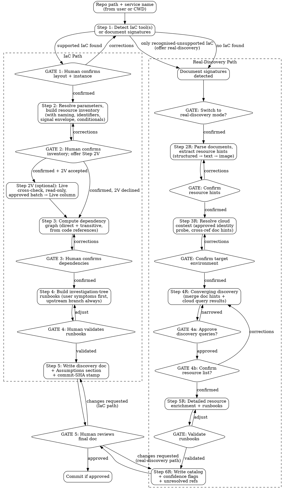

# Service Discovery

Scan a service's infrastructure-as-code repo and produce a troubleshooting-oriented inventory: a resource catalog, naming/tagging patterns, a dependency map, and per-symptom investigation runbooks. The output must be accurate enough that an on-caller who has never seen the service can use it to diagnose a live incident.

## The Iron Law

```
NO ASSUMPTIONS. IF UNCLEAR, ASK THE HUMAN.
NO OUT-OF-SCOPE ACTIONS WITHOUT HUMAN APPROVAL.
ONLY READ INFRASTRUCTURE-AS-CODE AND DOCUMENTATION FILES. NEVER READ SECRETS.
NOTHING UNPROJECTED REACHES THE CATALOG.
```

**Real-discovery extension (when no IaC is found):**

```
NO WRITE API CALLS. EVER.
ALL CLOUD QUERIES ARE READ-ONLY. NO EXCEPTIONS.
```

## Constraints (Non-Negotiable)

1. **Code is the source of intent; live infrastructure is the source of state.** Every claim in the catalog must trace back to a specific file and line in the repo, or to a cited read-only live query. Do not invent resources, dependencies, or thresholds from outside knowledge of "what services usually look like." If neither the code nor a live query says it, the catalog does not say it. Where both exist and disagree, the catalog shows **both** values as drift — never silently picks one (Step 2V). Label the basis of every claim and decision: `code: <path>:<line>`, `live: <command>` (with the time it ran), `docs: <URL>` (official AWS / Kubernetes / tool documentation fetched in this session, with the date) for how something *behaves* (restart, failover, reconcile, revert), `operator-stated`, or `UNVERIFIED`. Behaviour recalled from memory is not evidence. `UNVERIFIED` is never written as `none`, `safe`, `small` or `not present`.
2. **No assumptions.** If anything is unclear during discovery — a resource's purpose, a naming token, a dependency, an unresolved parameter, whether a conditional resource is enabled in the target instance — STOP and ask the human. An incomplete catalog with explicit questions is better than a complete catalog with wrong claims.
3. **Stop at the stack boundary.** A "stack" is the deploy unit (Terraform root module, ecspresso/lambroll config, Helm release, Kustomize overlay, raw-manifest path + namespace). Read everything inside the in-scope stack(s); do NOT follow references into other stacks. Cross-stack references get recorded as *dependencies*, not chased.
4. **Strict scope.** Anything outside the named repo paths — running cloud CLIs, modifying infrastructure, reading other repos, calling external APIs — requires explicit human approval before you do it.
5. **No secrets, ever — by exclusion and by projection.**
   - **Never open:** `*.tfstate*` (state holds plaintext secrets), `*.enc.*`, `*.sops.*`, `*.secret.*`, `secrets*.yaml`, `secrets/`, `.env*`, env files passed via `--envfile`, `*.pem`, `*.key`, `id_rsa*`, kubeconfig files, files inside `vault/`, helm-secrets values, Kustomize `secretGenerator` sources, files referenced by SOPS / sealed-secrets / Doppler / 1Password CLI.
   - **Never run:** `terraform state …`, `terraform output`, `terraform init|plan|apply`, `helm get values|manifest`, `sops -d`, `kubectl get secret`, `aws secretsmanager get-secret-value`, `aws ssm get-parameter(s) --with-decryption`.
   - **Names only** from `*.tfvars`, `*.auto.tfvars`, Helm values and other parameter files: record variable names and non-secret values. A value is withheld and recorded as `<set in <file>:<line>>` when its variable is declared `sensitive = true`, or its key contains (case-insensitive) `password`, `passwd`, `secret`, `token`, `key`, `private`, `credential`, `dsn`, `conn`, `auth`, or `cert`.
   - **Projected live queries only:** every cloud or cluster command the skill itself runs uses an explicit field allowlist (`--query`, `-o jsonpath`, `-o custom-columns`). No full-object `-o json|yaml`, no AWS Config `configuration` column, no Lambda `Environment`, no container `environment` values, no origin custom headers. Commands marked **terminal only** in `examples/` are for on-callers and are never used to build the catalog.
   - When code or a workload declares a secret reference (e.g., `aws_secretsmanager_secret_version`, `data.vault_generic_secret`, `secretKeyRef`, `valueFrom` ARN), record the *reference* — name, ARN, key names — never a value. A value that is itself a reference (a Secrets Manager / SSM ARN or parameter name, e.g. `DB_SECRET_ARN = arn:aws:secretsmanager:…`) is recorded as-is even when its key matches the names-only list.
6. **Resolve to a single, named instance — and, for live queries, a single pinned identity.** A repo is a template; the catalog is about a specific instance (one environment, one region, one tenant — whatever the smallest deploy-target unit is in this repo). Confirm with the human which instance is being cataloged before scanning. Live queries (Step 2V, real-discovery) run against one confirmed AWS account + region and/or one kube context; every command carries `--profile`/`--region`, or `--context` (`--kube-context` for Helm), and the identity is re-checked before each batch — a change aborts the run.
7. **User confirmation at every gate** in the active path (IaC or real-discovery). None are optional; optional *steps* (Step 2V) are offered at a gate, never skipped silently.
8. **Recognise, don't improvise.** CloudFormation, SAM, Serverless Framework, CDK and Ansible are recognised by `tool-detectors/` but not supported: list what was found, say so, and stop the IaC path for those stacks. "Teach me" is never offered for a recognised unsupported tool.

## Rationalization Prevention

| Thought | Reality |
|---------|---------|
| "This resource is probably X" | STOP — read the code or ask. |
| "The naming pattern is obviously…" | STOP — verify from the code; report what the code actually says. |
| "I'll resolve `${var.x}` to its default value" | STOP — defaults can be overridden per instance. Resolve from the actual instance's parameter source, or ask. |
| "I'll just follow this module reference into the other stack" | STOP — other stacks are out of scope. Record the cross-stack reference as a dependency and stop. |
| "This `.env` file might tell me which region this deploys to" | STOP — never read files in the secrets-shape. Ask the human for non-secret config. |
| "I can skip the dependency-graph step; nothing depends on this service" | STOP — verify by tracing references in the code; absence of evidence is not evidence of absence. |
| "I'll write the runbook section without confirmation" | STOP — runbooks must be validated against the user's actual investigation patterns. |
| "The four golden signals don't apply to this resource type" | STOP — record the envelope as `n/a` with a reason, don't omit. |
| "The documents are clear enough, I don't need to run cloud queries to verify" | STOP — documents may be outdated. The converging discovery approach exists because neither source is reliable alone. |
| "I'll skip the broad discovery query gate since it's all read-only" | STOP — the operator must see and approve every query before execution. Read-only does not mean ungated. |
| "This image diagram is too blurry to extract anything useful" | STOP — present what you can extract with `[uncertain]` markers. The operator can confirm or discard. |
| "The credentials don't match the documents but they're probably the right account" | STOP — flag the mismatch at the Step 3R gate. Mismatched credentials → wrong account → wrong resources in catalog. |
| "I'll run a write API to tag this untagged resource for easier discovery" | STOP — NO WRITE API CALLS. EVER. Record the resource as-is. |
| "Terraform state would resolve these parameters instantly" | STOP — state holds plaintext secrets. Never read it. Ask the human, or resolve via Step 2V's projected live query. |
| "The tfvars file is just config, I'll copy the values in" | STOP — names and non-secret values only. Secret-shaped or `sensitive` values become `<set in file:line>`. |
| "The query returned every RDS in the region, they're probably all the service's" | STOP — cloud-only results need a membership signal; otherwise they go to "Unattributed — operator assigns". |
| "Nothing came back, so the documented resource is gone" | STOP — empty is not absent. Was it queried in the right account/region? Is it global or untagged? Record `not-found (queried …)`, `not-queried` or `not-queryable`. |
| "This is a serverless.yml, I'll use 'teach me' to catalog it" | STOP — Constraint 8. Recognised, unsupported: say so and stop the IaC path; offer real-discovery against live AWS. |
| "Everything in this stack is the service" | STOP — a root module, chart or overlay can serve several services. Include a resource only with a membership signal (Step 2); the rest is Unattributed. |
| "I know what restarting / failing over / deleting this does, so I'll state the blast radius" | STOP — recall is not evidence. Cite `docs:` for the behaviour and `code:` / `live:` for what limits it, or write `blast radius UNVERIFIED — assume the whole service`. |
| "The code is the source of truth, so I don't need to look at live state" | STOP — offer Step 2V. Code is intent; a catalog that names resources that don't exist sends the on-caller the wrong way. |

## Red Flags — STOP and Follow Process

| Red Flag | What to do |
|----------|------------|
| Writing the discovery doc before the human confirms inventory and dependencies | STOP → return to the inventory gate (Step 2) and resolve. |
| Skipping the IaC-tool-detection sub-step because "this is obviously Terraform" | STOP → run detection anyway; mixed-tool repos are common. |
| Filling in the dependency section by guessing or by general knowledge of the cloud | STOP → derive from code references only; ask the human for anything inferred. |
| Reading a file outside the named repo paths without approval | STOP → ask the human for permission. |
| Building investigation runbooks before the resource inventory is confirmed | STOP → return to Step 2. |
| A naming-pattern token whose origin you can't point at in the code | STOP → re-trace, or ask the human. |
| Producing a runbook that has no user-visible-symptom anchor | STOP → rewrite to lead with the user-facing symptom. |
| Producing a runbook that has no "is this an upstream dependency?" branch | STOP → add the dependency-first branch. |
| Emitting a final catalog without the "Assumptions and Caveats" section | STOP → add it. The catalog is incomplete without it. |
| Continuing after the human says something is wrong without addressing it | STOP → fix all flagged issues before proceeding. |
| Running cloud API queries before the operator approves the cloud context (Step 3R gate) | STOP → return to Step 3R and present credentials for approval. |
| Running broad discovery queries before the operator approves them (Step 4R gate 4a) | STOP → return to Step 4R and present proposed queries. |
| Using a write/mutating API call during any real-discovery step | STOP → replace with the read-only equivalent. There is no exception. |
| Proceeding with real-discovery when IaC files are present in the directory | STOP → IaC found means IaC path. Real-discovery is the fallback, not an option. |
| Treating vision-extracted hints as high confidence without operator confirmation | STOP → vision hints are always Low confidence. Present with `[uncertain]` markers at Step 2R gate. |
| A secret value, full object dump, or unprojected API response about to be written to the catalog | STOP → Constraint 5. Replace with the projected fields or a `<set in file:line>` / reference. |
| A cloud or kubectl command without `--profile`/`--region` or `--context` | STOP → pin the identity (Constraint 6). |

## Workflow



---

### Step 1: Detect IaC Tool, Stack Layout, and Target Instance

**Inputs.** A repo path and a service name. If either is missing, ask. Detect a service name from the current working directory if the user said "discover this" without naming one.

**Detect the IaC tool(s) in the repo.** At the start of Step 1, load every file under `tool-detectors/*.md`. Each detector's `## File signatures` section defines what files signal that tool. Match the repo's files against every loaded detector. Record every tool that matches — a repo can use more than one. The currently-shipped detectors are listed in [`tool-detectors/README.md`](tool-detectors/README.md). Skip `.terraform/`, `node_modules/`, `cdk.out/`, vendored Helm subcharts (`charts/*/`) and `.git/` — they are downloaded or generated copies, not this repo's stacks.

**Recognised but unsupported tools** (detectors marked *recognition only*: CloudFormation, SAM, Serverless Framework, CDK, Ansible): list each match with its stacks, tell the operator it is not supported, and exclude those stacks from the IaC path (Constraint 8). If they are the **only** IaC in the repo, offer real-discovery against live AWS instead (the resources they deploy are AWS resources, which are supported; owner = the `aws:cloudformation:stack-name` tag, where present). That path starts with no resource hints (Seed A is empty unless the repo also holds documents): stack and file names are not resource hints, and the operator supplies the service tag key or name at Gate 4a. In a mixed repo, catalog the supported stacks and record the unsupported ones under Assumptions and Caveats.

For each matched detector, the rest of Step 1 (stack boundary detection) and Steps 2–3 (parameter resolution, resource extraction, dependency derivation) consult the corresponding sections of that detector file (`## Stack boundary`, `## Parameter sources`, `## Resource extraction`, `## Typical cross-stack dependencies`). If a detector omits a section, that dimension is unknown for the matched tool — surface the gap and ask the human.

**If no IaC tool is detected: scan for document signatures.** When the detector pass finds zero IaC tools, do not proceed to "Detect unclassified deploy artifacts." Instead, load every file under `doc-detectors/*.md` and scan the directory for matching file signatures. Each doc-detector's `## File signatures` section defines what files signal that format.

If document signatures are found, present:

> "No IaC files found in this directory. However, I found documentation and diagrams that may describe the infrastructure:
>
> | File | Format | Detected by |
> |------|--------|-------------|
> | `architecture.drawio` | Draw.io diagram | `doc-detectors/drawio.md` |
> | `runbook.md` | Markdown documentation | `doc-detectors/markdown.md` |
> | `infra-diagram.png` | Architecture image | `doc-detectors/image.md` |
>
> I can switch to **real-infrastructure discovery mode** — I'll extract resource hints from these documents, then verify against live cloud APIs (read-only) to build the same service catalog.
>
> **GATE: Switch to real-discovery mode? (Requires cloud credentials configured locally.)**"

If the operator confirms, proceed to **Step 2R** (Document Parsing). If the operator declines, STOP.

If neither IaC tools nor document signatures are found, STOP:

> "No IaC files, documents, or diagrams found in this directory. I need at least one of: infrastructure-as-code files, architecture documents, or architecture diagrams to begin discovery."

**Hybrid directories (IaC + documents):** If IaC files are found, the skill takes the IaC path regardless of whether documents are also present. Supplementing IaC discovery with document hints is out of scope for this version.

**Detect unclassified deploy artifacts.** After running the detector pass, scan the repo for files matching deploy-shape patterns (`*.yml`, `*.yaml`, `*.toml`, `*.json`) that were NOT attributed to any loaded detector. **Apply the secrets-exclusion rule first (Constraint 5) — exclude any file whose path matches secrets-shaped patterns (`*.enc.*`, `*.secret.*`, `secrets/`, `.env*`, `*.pem`, `*.key`, `id_rsa*`, `vault/`) before evaluating deploy-shape.** A file is "deploy-shaped" if its top level contains keys from this list: `service:`, `services:`, `cluster:`, `function:`, `functions:`, `task_definition:`, `app:`, `apps:`, `deploy:`, `provider:`, `runtime:`, `image:`, OR if any value contains an `arn:` or `s3://` reference.

If any unclassified deploy-shaped files are found, **STOP** and present:

> "I see these files that look like deploy descriptors but I don't recognize the tool: `<list>`. For each, please tell me one of:
> - **`<tool name>`** — if it's a known tool I should have a detector for (I'll flag this as a missing detector to contribute)
> - **`teach me`** — (only for tools within the supported stack — never for a recognised-unsupported or non-AWS tool) describe the stack boundary, parameter sources, and what cloud resources these files deploy. I'll use this for *this scan only* and recommend you contribute a detector file afterward.
> - **`ignore`** — these are not part of any in-scope stack (I'll record them in Assumptions and Caveats)."

Do not proceed to "Detect the stack layout" until every unclassified file has one of the three answers.

This sub-step exists because the Iron Law ("no assumptions, ask the human") cannot fire on files the skill does not look at. Silently skipping unrecognized deploy descriptors would produce a catalog that omits real deployed resources.

**Detect the stack layout.** A "stack" is the deploy unit:

- Terraform: each directory containing a root module (`provider` block + `terraform { backend ... }` or `terraform { required_providers ... }` at the top, no parent module calling it). Instances of a root module are typically multiplied by per-env `*.tfvars` files (commonly `envs/<env>.tfvars` or `terraform.<env>.tfvars`) passed via `-var-file`, by Terraform workspaces, or by Terragrunt environments.
- ecspresso / lambroll: each config file (`ecspresso.yml`, `function.json`, …) is a deploy unit; instances are multiplied by environment variables consumed through template functions (see the detectors).
- Helm: each `Chart.yaml` not vendored under another chart's `charts/` is a chart; each per-environment `values-<env>.yaml` (or each deployed release, or a `helmfile.yaml` / Argo CD `Application` / Flux `HelmRelease` entry) is one instance. The base `values.yaml` is the template's defaults, not an instance.
- Kustomize: each directory containing a `kustomization.yaml` / `Kustomization` (overlay) is an instance.
- Raw Kubernetes manifests: the manifest path + namespace the operator names; an Argo CD `Application` / Flux `Kustomization` pointing at the path is the deploy unit when present.

List the stacks. Note which produce one instance (one-off) vs. many (parameterized template).

**Identify the target instance.** Ask the human:

> "I see this repo is `<tool(s) detected>` and contains the following stacks: `<list>`. Which specific instance should I catalog? (e.g., name an environment, region, workspace, tenant, or release.)"

Do NOT guess. Multi-instance repos are the norm; the wrong instance produces a wrong catalog.

**Identify the ref that instance deploys from.** The catalog describes the code at one ref, so find which ref the instance is applied from: the branch or tag a pipeline applies, or the Argo CD / Flux `targetRevision` / `ref`. Cite where it was found (`code: <ci file or Application>:<line>`). If nothing in the repo shows it (manual delivery, an external pipeline), it is `UNVERIFIED`: ask, and record the answer as `operator-stated`. The checked-out branch is only a stand-in until then. Run `git status --short` on the stack paths and show uncommitted changes at the gate; the catalog does not describe uncommitted code as if it were a commit.

**Detect the parameter sources for the chosen instance.** Examples by tool:

- Terraform: `terraform.tfvars`, `*.auto.tfvars`, per-env `*.tfvars`, `TF_VAR_*` env vars (names only — ask the human for values), workspace name. **Never** state (Constraint 5); a `terraform_remote_state` lookup is recorded as a cross-stack dependency, not read.
- ecspresso / lambroll: environment variables and plugin lookups used by template functions (record the reference, e.g. a `tfstate` lookup address — never resolve it from state).
- Helm: `values.yaml` + `values-<env>.yaml` + `--set` overrides (names-only rule applies).
- Kustomize: overlay's patches + ConfigMap generators; Secret generators recorded by generator and key names only.
- Raw manifests: none beyond the files; `${VAR}` / envsubst placeholders are unresolved parameters.

Record where parameters come from, but do not resolve them yet. Apply Constraint 5 to every parameter file before reading it.

**Present and STOP.**

> "Service: `<name>`
> Repo: `<path>`
> IaC tool(s) detected: `<list>`
> In-scope stack(s): `<list>`
> Target instance: `<the one the user named>`
> Deployed ref: `<ref + basis (code: / operator-stated / UNVERIFIED)>`; checked out: `<branch@sha>`, working tree `<clean / N files changed>`
> Parameter source(s) for this instance: `<list of files/refs>`
> Out-of-scope (cross-stack refs to be recorded as dependencies, not followed): `<list>`
>
> Is this correct?"

Wait for human confirmation. Apply corrections and re-present until confirmed.

---

### Step 2: Resolve Parameters and Build Resource Inventory

**Resolve parameters.** For each parameter the in-scope stack(s) declare, resolve it to the value used by the target instance. Apply the precedence order in the matched detector's `## Parameter sources`. An order the detector marks `UNVERIFIED` is checked against the tool's own documentation (`docs: <URL>`, fetched this session) before it decides a value; if two sources set a value and the order is unverified, ask. Record each resolved value with where it came from (`value ← <file>:<line>`). A value that comes only from a declared default, or from a source the repo cannot show (variables injected by a pipeline or held in a remote workspace, `-var` flags, `valuesFrom`), is recorded `default / source unconfirmed` and the operator is asked where this instance's values come from; Step 2V is the live check for it. Secret-shaped or `sensitive` values are never resolved — they appear as `<set in <file>:<line>>` (Constraint 5).

If a parameter cannot be resolved (file not present, registry not reachable, value comes from a runtime-only source like an SSM parameter) — DO NOT proceed, and do not fetch it. List the unresolved parameters and ask the human to provide values or to confirm "skip with placeholder, mark as unresolved in catalog."

**Scan the in-scope stack(s).** Use file types from Step 1's tool detection. Read every IaC file in the stack(s). Read documentation files (`README.md`, `docs/**/*.md`) inside the stack(s) to pick up author-supplied context. Skip secrets-shaped files unconditionally.

**Membership — a stack is not automatically a service.** A root module, chart or overlay may serve several services. Include a resource in the inventory only with a membership signal the code shows: the service token in its name or the naming pattern the operator confirms at this gate, a service tag / label whose value is the service (`Service`, `app`, `app.kubernetes.io/name`, …), a declaration in a module call, file or directory named for the service, or a reference from a resource already included. Resources in the stack with no such signal go to **Unattributed — operator assigns** (shown at the gate, recorded `operator-assigned` if moved into the inventory). Ask the operator which resources belong to the service only when the stack shows more than one service-looking name prefix, or when membership cannot be proven from evidence (fail closed: if unsure, ask). When the stack shows a single prefix and every resource carries it, do not ask; record why in the catalog, e.g. `membership: single prefix <x>, code:<path:line>`. If the whole stack is the service's, say so at the gate and give the basis (`code:` / `operator-stated`).

**Use detector resource-extraction rules.** For each tool matched in Step 1, consult that tool's `## Resource extraction` section in its detector file. Apply the mappings to convert the tool's config keys into inventory rows. The `Type` field uses both the resolved cloud-resource equivalent (e.g., `aws_ecs_service`) AND the detector-prefixed raw type (e.g., `ecspresso/service`) so operators can see the deploy tool's role.

**Extract per resource:**

| Field | Meaning |
|-------|---------|
| Type | The IaC resource type, normalized to a category: compute / storage / database / network / messaging / identity / observability / edge / serverless / data-pipeline / other. Record both the raw type (e.g., `aws_ecs_service`, `ecspresso/service`, `apps/v1 Deployment`) and the category. |
| Name (resolved) | The actual resource name after parameter substitution — not the template. |
| Naming-pattern fragment | The template form, e.g., `${service}-${env}-${region}-${role}`. |
| Conditional? | If the resource depends on `count`, `for_each`, `enable`, a feature flag, or a Helm `if` — record the gating condition. |
| Identifying dimensions | What an operator would filter by during an incident: tenant id, shard key, region, AZ, deployment id, version. List the ones present in the resource definition or available via tags. |
| Signal envelope | For each critical-path resource, four lines: latency expectation (per percentile), traffic baseline, error budget / threshold, saturation limit (whichever bind first — CPU, memory, connections, queue depth). If declared in code (alarms, SLO objects, alerting rules) — quote it. If not declared — record `not declared` and surface it in the runbook. |
| Source location | File + line range. |
| Owner | The deploy tool that owns it (`terraform <root>`, `helm <release>`, `kustomize <overlay>`, `argocd <app>`, …). From live data: `cloudformation (<stack>)` when the `aws:cloudformation:stack-name` tag is present — recognition only. |
| Live (Step 2V) | `✓ matches (<fields compared>)` / `drift: <field> code=<x> live=<y>` / `not found in <account>/<region>` / `not checked`, with the query # that produced it. |

**Detect the naming pattern.** Look across multiple resources for the recurring template (e.g., `${var.service}-${var.env}-${each.key}`). Convert to placeholder form and present it explicitly. Do not invent placeholders the repo does not actually use. If the pattern is inconsistent across resources — record both forms and flag.

**Detect conditional / optional resources.** For each gated resource, write the gating expression and the resolved boolean for the target instance. A resource gated `enable_redis = true` in the target instance → mark "present"; gated and resolved false → mark "not present in this instance." Do this only from a confirmed value; if the gating value is `default / source unconfirmed`, write "present?" or "not present?" and carry it to the caveats.

**Present and STOP.**

> "Resolved parameters: `<key parameters with their resolved values>`
> Unresolved (needs your input): `<list, or "none">`
>
> **Resource Inventory for `<service>` / `<instance>`:**
>
> | Category | Type | Resolved Name | Naming Fragment | Conditional? | Identifying Dimensions | Signal Envelope | Source | Owner |
> | … | … | … | … | … | … | … | … | … |
>
> **Detected naming pattern(s):** `<list>`
> **Optional resources NOT present in this instance:** `<list>`
> **Unattributed — operator assigns:** `<stack resources with no membership signal, or "none — whole stack is the service (basis)", or "not asked — membership: single prefix <x>, code:<path:line>">`
>
> **Open questions:**
> - …
>
> Is this correct? Anything missing or wrong?
>
> **Optional — Step 2V live cross-check:** I can verify these resources against the live environment with read-only, projected queries (shown for approval first). Recommended: it catches names that don't exist and config that drifted from code. Run it? (yes / skip)"

Wait for confirmation. Apply corrections and re-present until confirmed.

---

### Step 2V: Live Cross-Check (IaC path, optional, offered by default)

*Code is the source of intent; live infrastructure is the source of state. This step compares them for the confirmed inventory. It never changes either.*

1. **Pin the identity.** Ask which AWS profile/region and/or kube context hold the target instance. Show and run (on approval) the probe: `aws sts get-caller-identity --profile <p> --query Account`, `aws configure get region --profile <p>` (STS does not return a region), `kubectl config current-context` / `kubectl --context <c> get ns <namespace> -o name`. The account/region/context must match what the code and the human say the instance is; a mismatch is a hard stop.
2. **Plan the batch.** One projected read per inventoried resource, using the enrichment commands in `examples/aws.md` / `examples/kubernetes.md` (never a **terminal only** command). Show the table: `# | resource | command (with --profile/--region or --context) | fields compared | cost (free unless stated)`. Global resources (CloudFront, IAM, Route 53, WAF `CLOUDFRONT`) are queried in `us-east-1`. **GATE: approve the batch.**
3. **Run and compare.** For each resource, fill the `Live` column: `✓ matches (<fields compared>)` (a match covers only the fields named), `drift: <field> code=<x> live=<y>`, `not found in <account>/<region>` (with the exact query), or `not checked (<reason>)`. Empty is not absent: before writing `not found`, confirm the query was in the right account/region and that the resource type is listable there.
4. **Surface, don't resolve.** Drift rows are listed at the top of Assumptions and Caveats. The catalog keeps the code value as the declared value and shows the live value beside it; the human decides which is wrong.

If declined, stamp the catalog `**Live verification:** not performed` and keep the `Live` column as `not checked`.

---

### Step 2R: Document Parsing & Resource Hint Extraction (Real-Discovery Path)

*This step runs instead of Step 2 when the real-discovery path is active.*

**Load matched doc-detector files.** For each document format detected in Step 1, load the corresponding `doc-detectors/*.md` file. Each detector defines how to parse that format and what resource hints to extract.

**Parse in reliability order.** Process documents from most to least structurally reliable:

1. **Structured diagrams first** (Draw.io, Mermaid, PlantUML) — these have explicit node/edge relationships encoded in XML, YAML, or DSL syntax. Parse using the detector's extraction rules.
2. **Text documents second** (Markdown, Confluence exports, plain text) — scan for resource mentions, ARNs, hostnames, IP ranges, region identifiers, service names, and other cloud context clues using keyword lists from the detector.
3. **Image diagrams last** (PNG, JPEG, SVG rasterized) — these require vision analysis and are the most token-heavy and least reliable. Use vision to extract resource labels, relationship arrows, grouping boundaries, and annotations.

**Extract per hint:**

| Field | Meaning |
|-------|---------|
| Resource type | The cloud resource type mentioned or depicted (e.g., "RDS instance", "S3 bucket", "ALB") |
| Resource name | Any specific name, identifier, or ARN mentioned |
| Relationships | Connections to other resources shown in the document (arrows, references, "connects to" language) |
| Cloud context | Region, account, VPC, subnet, or other placement clues |
| Service boundary | Which service or system the resource belongs to, if the document groups resources |
| Source document | The file and location (page, section, coordinates) where the hint was found |
| Extraction confidence | Documents describe intent, not state, so doc-derived hints are capped at **Medium** — explicitly named with identifiers (structured diagram or text). **Low** — inferred from an image or an ambiguous reference. Only live evidence (Step 4R) raises a resource to High. |

**Cloud context clues.** While extracting resource hints, collect any cloud context that helps narrow discovery in Step 3R:

- AWS account IDs, region names, VPC IDs
- Kubernetes cluster names, namespace names
- Domain names, IP ranges, CIDR blocks

**Present and STOP.**

> "**Resource hints extracted from documents:**
>
> | # | Hint | Type | Source | Confidence |
> |---|------|------|--------|------------|
> | 1 | `prod-api-db` | RDS instance | `architecture.drawio` (node 14) | Medium |
> | 2 | `api-cache` | ElastiCache cluster | `runbook.md` (section 3.2) | Medium |
> | 3 | Load balancer | ALB | `infra-diagram.png` (top-center) | Low |
>
> **Cloud context clues:**
> - Region: `us-east-1` (mentioned in `runbook.md`)
> - Account: unknown
> - VPC: `vpc-abc123` (shown in `architecture.drawio`)
>
> **GATE: Do these hints look accurate? Remove/add/correct any before proceeding.**"

Wait for confirmation. Apply corrections and re-present until confirmed.

---

### Step 3R: Cloud Context Resolution (Real-Discovery Path)

*This step runs instead of Step 3 when the real-discovery path is active.*

**Probe local credentials — show the probe first.** List the probe commands and run them only on approval (they are read-only, but every query is shown before it runs):

- AWS: `aws sts get-caller-identity --profile <p> --query '{Account:Account,Arn:Arn}'` and `aws configure get region --profile <p>` (or `AWS_REGION`). STS returns no region — the region always comes from the profile/env and is shown separately.
- Kubernetes: `kubectl config current-context` (local file, no API call) and `kubectl --context <c> cluster-info` only if the operator wants reachability checked.

If no credentials are found, STOP:

> "No cloud credentials found. Real-discovery requires an AWS profile or a Kubernetes context to verify resource hints against live infrastructure. Please configure credentials and retry."

**Cross-reference credentials with document hints.** Compare the provider, account/project, and region from the credential probes with the cloud context clues extracted in Step 2R. Flag any mismatches — a credential pointing at `us-west-2` when documents reference `us-east-1` resources is a strong signal that the wrong profile is active.

**Present and STOP.**

> "**Cloud context resolution:**
>
> | Provider | Identity Source | Value | Doc Hint | Match? |
> |----------|----------------|-------|----------|--------|
> | AWS | `sts get-caller-identity` + `configure get region` (profile `prod-ro`) | Account `123456789012`, region `us-east-1` | Account: unknown, Region: `us-east-1` | Region matches; account unverifiable from docs |
> | Kubernetes | `kubectl config current-context` | `prod-eks-cluster` | Cluster: `prod-cluster` (from drawio) | Partial — name differs |
>
> **GATE: Is this the correct target environment?**"

**Hard rule: no discovery queries before this gate passes** — only the approved identity probe above. Running queries against the wrong account produces a catalog of the wrong infrastructure. From here on, every command carries `--profile`/`--region` or `--context`, and the identity is re-checked before each batch (Constraint 6).

**Out-of-scope providers.** If document hints reference GCP, Azure or another cloud, record them under Unresolved References as `out of scope — not queried`. If hints span AWS and a Kubernetes cluster, confirm each context independently.

Wait for confirmation. Apply corrections and re-present until confirmed.

---

### Step 4R: Converging Discovery (Real-Discovery Path)

*This step runs instead of Step 4 when the real-discovery path is active.*

This step merges two independent discovery seeds to build a verified resource list:

- **Seed A: Confirmed document hints** from Step 2R (operator-reviewed).
- **Seed B: Cloud-discovery templates** — load matching templates from `cloud-discovery/` based on the confirmed cloud context. Each template defines broad discovery queries for a resource category.

**Present proposed queries and STOP.**

> "**Proposed discovery queries:**
>
> I'll run these read-only queries to discover resources in the confirmed environment:
>
> | # | Query | Scope | Source |
> |---|-------|-------|--------|
> | 1 | `aws resourcegroupstaggingapi get-resources --tag-filters Key=Service,Values=prod-api --profile prod-ro --region us-east-1 --query 'ResourceTagMappingList[].{Arn:ResourceARN,Tags:Tags}'` | Tagged resources, us-east-1 | `cloud-discovery/aws.md` |
> | 2 | `aws ec2 describe-instances --filters Name=vpc-id,Values=vpc-abc123 --profile prod-ro --region us-east-1 --query '<projection>'` | Instances in confirmed VPC | `cloud-discovery/aws.md` |
> | 3 | `aws rds describe-db-instances --db-instance-identifier prod-api-db --profile prod-ro --region us-east-1 --query '<projection>'` | The documented DB only | `cloud-discovery/aws.md` |
> | 4 | `kubectl --context prod-eks-cluster get deploy,sts,ds,svc,ing -n prod-api -l app=prod-api -o custom-columns=<projection>` | Workloads in the confirmed namespace | `cloud-discovery/kubernetes.md` |
>
> **GATE 4a: Approve these discovery queries?**"

If the operator declines specific broad queries (e.g., "don't scan all RDS instances, just look for the ones in the documents"), proceed with Seed A only for those resource types. Resources discovered only via Seed A are flagged `documented-only, not verified`.

**Execute approved queries.** Run each approved query and collect results. Do NOT run any query the operator did not approve.

**Membership.** A cloud result belongs to this service only with a **membership signal**: the service tag (AWS) or label (Kubernetes: `app`, `app.kubernetes.io/name`, …) key the operator confirmed (`Team` / `Owner` / `Project` tags and `component` / `part-of` labels are only hints), a name matching a naming pattern the operator states or one derived only from resources that already have another signal (a pattern derived from the unattributed results themselves is circular), or a reference from an already-confirmed resource (AWS: security group, target group, IAM role, event source, DNS record; Kubernetes: ownerReferences, a Service selector or Ingress backend naming a confirmed workload, a ServiceAccount / ConfigMap / PVC its pod spec uses). Results without one go to an **Unattributed — operator assigns** list, never into the inventory by default. A region-wide or namespace-wide query is a search space, not a membership claim.

**Absence.** Empty is not absent. The Tagging API is regional and only returns tagged (or previously tagged) resources; global services (CloudFront, IAM, Route 53, WAF `CLOUDFRONT`) live in `us-east-1`; a wrong profile or region returns `[]`. In Kubernetes a wrong context or namespace, an RBAC `Forbidden` and a missing CRD are likewise not absence. Classify each documented resource that wasn't found as `not-found (queried <account>/<region> with <query #>)`, `not-queried` (operator declined, or no query covers its type), or `not-queryable` (global or untagged and no direct describe was run).

**Merge seeds and assign confidence.**

| Condition | Confidence | Flag |
|-----------|------------|------|
| Resource found in docs and in cloud (with membership signal), matched on the same identifier (full ARN, including one that the document's own parts plus the confirmed account and region fully determine; or kind + namespace + name in the confirmed context) | **High** | *(none)* |
| Same, but matched on name or type alone | **Medium** | `name-match-only` |
| Resource in docs only | **Low** | `documented-not-found` + absence class (`not-found (…)` / `not-queried` / `not-queryable`) |
| Resource in cloud only, with membership signal | **Medium** | `undocumented` |
| Resource in cloud only, no membership signal | — | listed under **Unattributed — operator assigns** |

**Present merged resource list and STOP.**

> "**Merged resource list for `<service>`:**
>
> | # | Resource | Type | Source | Confidence | Flag |
> |---|----------|------|--------|------------|------|
> | 1 | `prod-api-db` | RDS instance | docs + cloud | High | |
> | 2 | `api-cache` | ElastiCache cluster | docs only | Low | `documented-not-found` — not-found (queried 123456789012/us-east-1, #4) |
> | 3 | `prod-api-alb` | ALB | cloud only | Medium | `undocumented` |
>
> **GATE 4b: Confirm this resource list before detailed discovery?**"

> **Unattributed — operator assigns:** `<resources found by broad queries with no membership signal>`

The operator can add, remove, or reclassify resources at this gate, including moving unattributed resources into the inventory (recorded as `operator-assigned`). Resources flagged `documented-not-found` are excluded from enrichment in Step 5R but are recorded in the final catalog's Unresolved References section with their absence class.

Wait for confirmation. Apply corrections and re-present until confirmed.

---

### Step 5R: Detailed Resource Enrichment (Real-Discovery Path)

*This step enriches each confirmed resource from Step 4R with detailed configuration, relationships, and health data.*

**Use the enrichment (projected) commands in `examples/aws.md` / `examples/kubernetes.md`** — the same ones Step 2V uses. Never a command marked **terminal only**. Every command carries `--profile`/`--region` or `--context`; re-check the identity before the batch.

**Data collected per resource:**

| Category | What to collect |
|----------|----------------|
| Configuration | Instance type/size, storage, engine version, runtime and scaling config — projected fields only. Environment variables: **names only**; secret references by name/ARN. |
| Relationships | Security groups, subnets, VPC, IAM roles, attached policies, target groups |
| Health/status | Current state, last event, active alarms, recent metrics (if accessible) |
| Tags/metadata | Tags, creation date, last modified, ARN/resource ID, owner (`aws:cloudformation:stack-name`, `app.kubernetes.io/managed-by`, Argo CD / Flux labels) |
| Access/security | Public accessibility, encryption status, endpoint hostnames (no query strings, tokens or presigned URLs), access logging |

**Dependency walking.** Using the enrichment data, link confirmed resources to each other:

- Security group references → which resources share security groups
- Subnet/VPC placement → which resources are co-located
- IAM role references → which resources share identity
- Target group membership → which resources sit behind which load balancers
- DNS/endpoint references → which resources connect to which

Note but do not chase references that cross the service boundary (e.g., a security group rule allowing traffic from an unknown CIDR). Record these as boundary dependencies, the same way the IaC path records cross-stack references.

**Report surprises.** If enrichment reveals resources that contradict document hints (e.g., a resource exists but with a different configuration than documented, or a documented relationship doesn't exist in practice), report them inline. This is informational — no gate required. The operator already confirmed the resource list at Gate 4b; surprises are noted in the catalog.

**Build runbooks.** Follow the same Step 4 process as the IaC path: enumerate user-visible failure modes, build investigation-tree runbooks with upstream-first branches, validate with the operator. Real-discovery has an advantage here — live health data and actual resource configurations are available. Live metrics give an **observed** baseline (statistic, window, date), recorded as `observed`, never as a limit or threshold. Only alarm, SLO and alerting-rule definitions that were read count as `declared`.

**Present all runbooks and STOP.** Wait for the operator to validate the trees, same as Step 4 in the IaC path.

---

### Step 6R: Write the Catalog (Real-Discovery Path)

*This step produces the same catalog format as the IaC path, with additional metadata reflecting the real-discovery source.*

**Output path.** Same as the IaC path: `.culiops/service-discovery/<service>[-<instance>].md`.

**Stamp the catalog.** Top of the doc, with additional source metadata:

```
**Discovery source:** real-discovery
**Discovery date:** `<YYYY-MM-DD>`
**Cloud context:** `aws` / `<account>` / `<region>` and/or kube context `<context>`
**Documents used:** `<list of source documents from Step 2R>`
**Target instance:** `<instance name>`
```

**Confidence flags in the catalog.** Resources carry their confidence and flag from Step 4R:

- `undocumented` resources include a note in their inventory entry: *"Discovered via cloud API only — not referenced in any source document. Verify this resource belongs to this service."*
- `documented-not-found` resources appear in a dedicated `## Unresolved References` section (not in the main inventory): *"Referenced in `<source document>` but not found in the live environment. May be decommissioned, renamed, in a different account/region, or the document may be outdated."*

**All other catalog sections follow the IaC path format.** The section order from Step 5 applies:

1. `## Overview` — includes "discovered via real-discovery (documents + live cloud APIs)" instead of IaC tool names.
2. `## Prerequisites` — same structure, derived from the `examples/` files used during enrichment.
3. `## Resource Inventory` — from Step 4R's confirmed list, enriched in Step 5R. Grouped by category.
4. `## Naming Patterns` — detected from actual resource names rather than IaC templates.
5. `## Identifying Dimensions` — derived from tags, naming patterns, and resource placement.
6. `## Dependency Graph` — from Step 5R's dependency walking. Critical-path marked.
7. `## Signal Envelopes` — declared alarms / SLOs marked `declared`; live metric statistics marked `observed (<statistic>, <window>, <date>)`.
8. `## Investigation Runbooks` — from Step 5R's runbook building.
9. `## Stack-Specific Tooling` — which `examples/<cloud>.md` file applies.
10. `## Unresolved References` — `documented-not-found` resources (real-discovery-specific section).
11. `## Assumptions and Caveats` — **mandatory**, with real-discovery-specific caveats:
    - *"This catalog was built from real-discovery (documents + live cloud APIs), not from infrastructure-as-code. Resources may exist that are not managed by any IaC tool."*
    - *"Document sources may be outdated. Resources marked `documented-not-found` were referenced in documents but not found in the live environment."*
    - *"Resources marked `undocumented` were found in the live environment with a membership signal but are not referenced in any source document. Resources with no membership signal are listed as Unattributed and are not part of this catalog unless operator-assigned."*
    - *"No drift detection is possible without IaC — the catalog reflects the live state at discovery time."*
12. `## Open Questions` — anything the operator said "I don't know, ask me later."

**Present and STOP.**

> "Catalog written to `.culiops/service-discovery/<filename>.md`. Please review the file.
>
> **GATE: Review catalog before writing? Should I commit it?**"

Committing follows the rule in Step 5.

---

### Step 3: Compute the Dependency Graph

**Direct dependencies** — derive from the code:

- Terraform: `depends_on`, references between resources, `data` lookups across providers, `terraform_remote_state` lookups, module `source` references.
- ecspresso / lambroll: `tfstate` / `ssm` template-function lookups (record the address or path as the linkage — never resolve it), hardcoded ARNs, cluster and target-group references.
- Helm: `requirements.yaml` / `Chart.yaml` `dependencies`, ConfigMap/Secret refs, ServiceAccount + RBAC bindings.
- Kustomize: bases / `resources:` (remote bases recorded, not fetched), `components:`, `replacements`, `patchesStrategicMerge` targets.
- Raw manifests: ConfigMap/Secret refs (names only), ServiceAccount + IRSA `eks.amazonaws.com/role-arn` annotations, Ingress controller annotations, PVC storage classes.
- For tools matched via a detector, also consult the detector's `## Typical cross-stack dependencies` section as a hint for what kinds of upstream references to look for. The actual graph is still derived from references in code — the hints help you avoid missing common patterns.

For each dependency, record: the upstream resource (or stack), the linkage (output name, exported value, registry key), and whether the linkage is hard-coded or parameterized.

**Transitive dependencies** — for each direct upstream that itself is in a different stack, you do NOT chase into that stack (Iron Law: stop at boundaries). But you DO record:

- The upstream stack name (as the human knows it).
- What the in-scope stack consumes from it.
- The expected protocol / interface (HTTP, gRPC, queue, event bus, shared database, shared registry, etc.). Cite the code that shows it (`code:`, e.g. a listener / target group, an endpoint in the service's environment, an event-source mapping); when it is only inferred from the referenced resource type, label it `inferred`.
- Anything the human tells you about that stack's reliability characteristics (SLO, blast radius, on-call team).

If the human can't characterize an upstream, mark it "**unknown — investigation entry point**" and surface it in the runbook so on-callers don't dead-end.

**Critical-path classification.** For each direct dependency, ask: does a user request to this service synchronously traverse it? Yes → critical path. No → eventual / async / observability-only. Record the basis per edge (`code:` / `operator-stated` / `inferred`). Infrastructure code often cannot show whether a call is synchronous: then the edge is `critical-path: unknown`, confirmed at the gate, and never defaulted to async.

**Render.** Produce a dependency graph (an indented list is fine if a DOT block isn't needed). Mark critical-path edges. Mark cross-stack dependencies. Mark cross-region / cross-account dependencies (these are blast-radius signals).

**Present and STOP.**

> "**Dependencies for `<service>` / `<instance>`:**
>
> Upstream (this service depends on):
> - `<name>` [critical-path / async] — linkage: `<output X of stack Y>`; protocol: `<inferred>`; reliability characteristics: `<from human or "unknown">`
> - …
>
> Downstream (depends on this service): `<inbound references found in the repo with code:, plus anything the human knows; if none, "none found in this repo — consumers in other repos / stacks are not visible", never "none">`
>
> Shared infrastructure (same-stack co-tenants whose failure correlates): `<list>`
>
> Is this graph correct? Are there upstream/downstream edges I missed?"

Wait for confirmation. Apply corrections and re-present until confirmed.

---

### Step 4: Build Investigation-Tree Runbooks

For each user-visible failure mode of the service, build a **decision tree**, not a script. The tree's job is to guide a methodical operator from a symptom to a hypothesis to a test to the next narrowing question.

**Step 4a: Enumerate user-visible failure modes.** Ask the human (or derive from existing alarm definitions found in code) which user-facing symptoms the service can exhibit. Frame them in user terms:

- "User-facing requests slow / timing out"
- "User-facing requests returning errors"
- "User-facing requests returning wrong / stale data"
- "Background processing for users is delayed"
- "<service-specific failure mode the human names>"

These categories replace the legacy alarm-name vocabulary ("5xx spike", "queue backlog"). The technical signals (HTTP 5xx, queue depth) live *inside* the tree as branches, not as the headline.

**Step 4b: Build each tree.** Every runbook must contain, in order:

1. **Anchor — what the user sees.** Sentence one: the user-visible symptom. Sentence two: which SLI/SLO this corresponds to (or "no declared SLI — establish a baseline").
2. **First branch — is this an upstream issue?** List the critical-path dependencies (from Step 3). For each: how to check it (named query / dashboard / metric — generic; the per-cloud commands live in `examples/`). If any upstream is unhealthy, the runbook for *this* service ends and the upstream's runbook takes over.
3. **Second branch — narrow on identifying dimensions.** Use the dimensions captured in Step 2: is this affecting all tenants or one? all regions or one? all shards or one? all deployments or only the latest? Narrowing on dimensions is the single highest-leverage debugging move. Each narrowing answer rules hypotheses in or out.
4. **Third branch — four-signals walk-through.** For each critical-path resource, in dependency order: check latency, traffic, errors, saturation against the envelope from Step 2. The envelope comparisons drive the next branch ("latency p99 above envelope on resource X → check X's saturation → check X's upstream"). If a resource has no declared envelope, the branch is "compare against last 7-day baseline."
5. **Tools branch — what to look at, where.** For each check, name the dashboard / log query / CLI. The skill writes this generically here ("check ALB target group health"); the per-cloud `examples/<cloud>.md` provides exact CLIs. If the operator needs a permission or a secret to run a check, name it ("requires read access to <secret reference>"). Every prescribed CLI is **read-only by default** — the required least-privilege role lives in the matching `examples/<cloud>.md` preamble. If a step would change state (drain, restart, failover, invalidate, scale, rollback, DNS change, config change), label the step **`MUTATION — requires explicit approval`**, state the blast radius, state the elevated permission required, and instruct the operator to pause and confirm with the team before running. The blast radius comes from evidence, not recall: how the command behaves (restart, failover, eviction, reconcile) cites `docs: <URL>` fetched this session, and what limits it (replica count, PodDisruptionBudget, Multi-AZ, rolling-update settings) cites `code:` (or `live:` after Step 2V). If either is missing, write `blast radius UNVERIFIED — assume the whole service`, not a reassurance such as "small". Name the owner's route too: a hand change to a resource whose Owner is a GitOps controller can be reverted at the next sync (Argo CD self-heal re-syncs live state to Git — `docs: https://argo-cd.readthedocs.io/en/stable/user-guide/auto_sync/`) and one owned by an IaC tool shows as drift at the next apply, so give the change through its owner (Git change, paused sync, IaC change) as the first route and the direct command only as a labelled emergency option. The runbook must never chain commands such that one command's output triggers the next without a human review pause.
6. **What this is NOT.** A line per false-friend: the symptoms that *look* like this category but are actually a different one, with a pointer to the right runbook.

**Step 4c: Validate.** For each runbook tree, ask the human:

- "Does this match how your team would actually investigate this symptom? Is there a step you'd take first that's not here?"
- "Has this service had an incident in this category? If yes, would this tree have led the on-caller to the cause?"

If the team has postmortems for past incidents in this category, reference them in the tree.

**Present all runbooks and STOP.** Wait for the human to validate the trees. Adjust ordering, add branches, remove dead-end branches as requested.

---

### Step 5: Write the Discovery Document

Only after Steps 1-4 are all confirmed.

**Output path.** `.culiops/service-discovery/<service>[-<instance>].md`. All output documents produced by any `culiops` skill live under the `.culiops/` directory at the repo root — this keeps plugin-generated artifacts separate from hand-written docs and makes them easy to find, regenerate, or gitignore as a group. If a single instance is cataloged, suffix the filename with the instance name (e.g., `-prod-eu`). If the catalog covers all instances of the same template (rare and only if the human confirms it's safe to combine), no suffix.

**Stamp the catalog.** Top of the doc:

```
**Cataloged from commit:** `<short SHA>`
**Working tree:** `clean` | `<N> uncommitted files in the stack`
**Deployed ref:** `<ref>` — `code:` / `operator-stated` / `UNVERIFIED`
**Cataloging date:** `<YYYY-MM-DD>`
**Target instance:** `<instance name>`
**IaC tool(s):** `<list>`
**Live verification:** `performed <YYYY-MM-DD> against <account>/<region>[, context <c>]` | `not performed`
```

**Sections, in order:**

1. `## Overview` — service name, instance, tool(s), short purpose (from human or repo README).
2. `## Prerequisites` — what the on-caller must have set up before using this catalog during an incident. Lists: (a) the required CLI tool(s) and minimum versions (from the matching `examples/<cloud>.md` preamble); (b) how to authenticate; (c) the **least-privilege IAM role / scope** needed to run the read-only commands the runbooks reference; (d) any runbook step in this catalog that involves a **mutation** (drain, restart, failover, invalidate, scale, rollback, DNS change, config change) — listed with the elevated permission required and the team-approval expectation.
3. `## Resource Inventory` — the table from Step 2, grouped by category.
4. `## Naming Patterns` — detected patterns, with the placeholder taxonomy used.
5. `## Identifying Dimensions` — the cross-cutting dimensions (tenant, region, shard, etc.) operators can pivot by.
6. `## Dependency Graph` — from Step 3. Critical-path marked.
7. `## Signal Envelopes` — per critical-path resource, the four-signals envelope and where it's measured.
8. `## Investigation Runbooks` — one per user-visible symptom from Step 4. Trees rendered as nested lists or DOT blocks.
9. `## Stack-Specific Tooling` — which `examples/<cloud>.md` file applies, with a 1-line note for any third-party tool the catalog references that doesn't live in `examples/` (the operator will need to ask the team).
10. `## Assumptions and Caveats` — **mandatory**. Drift status: the Step 2V drift rows first (or "live verification not performed — running infra may differ from code at commit X"). Recognised-unsupported stacks found in the repo and excluded. Unresolved parameters (any that were skipped) and values resolved from a default or an unconfirmed source. The **Unattributed — operator assigns** list. **Completeness:** the inventory lists what the code declares (plus operator-assigned resources); resources created outside it (console, runtime, other stacks) are not listed. Steps requiring secrets or elevated permissions. Upstream stacks marked "unknown." Anything else the operator should not be surprised by. **Mandatory line if the escape hatch fired:** if any "teach me" or "ignore" answer was used in Step 1's "Detect unclassified deploy artifacts" sub-step, add the line: *"Tool `<X>` was not pre-known to the skill; the [stack boundary / parameter resolution / resource mapping] for this tool came from operator input during this scan and is not encoded in any detector file. Recommend contributing `tool-detectors/<X>.md`."*
11. `## Open Questions` — anything the human said "I don't know, ask me later."

**Placeholder taxonomy.** Use only the placeholders the repo actually uses, detected in Step 2. Common ones:

| Placeholder | Description |
|-------------|-------------|
| `{service}` | The service identifier as it appears in resource names |
| `{instance}` | The target instance (env/region/tenant — whatever the repo's smallest deploy unit is) |
| `{T-1h}`, `{T-15m}` | One hour ago / fifteen minutes ago, ISO 8601 |
| `{now}` | Current time, ISO 8601 |

Repo-specific placeholders (e.g., `{shard}`, `{tenant}`, `{region}`, `{role}`, `{version}`) are added based on what Step 2 detected. Do NOT pre-declare placeholders the repo doesn't use.

**Present and STOP.**

> "Discovery doc written to `.culiops/service-discovery/<filename>.md`. Please review the file. Should I commit it?"

**Before writing**, scan the draft for anything Constraint 5 forbids (secret-shaped values, full object dumps, presigned URLs, env values) and fix it.

**Committing.** Only on approval. Show the current branch; if it is the repository's default branch, ask before committing there. Run `git remote -v`; if the remote is or may be public, warn that the catalog names accounts, resources and dependencies. Commit message: `Add service discovery doc for <service> (<instance>)`, staging only the catalog file.

---

## Stack-Specific Examples

For exact CLI command templates, see:

- AWS: [`examples/aws.md`](examples/aws.md)
- Kubernetes & Helm (any host): [`examples/kubernetes.md`](examples/kubernetes.md)

Each file separates **enrichment commands** (projected; used by Step 2V and Step 5R, safe for the catalog) from **terminal only** commands (for on-callers during an incident; may print secrets or PII; never used by the skill to build the catalog).

**Selection rule.** Cloud and Kubernetes are orthogonal axes — pick one or both:

- AWS IaC detected (`aws_*` resources, ecspresso, lambroll) → use `examples/aws.md`.
- Helm charts, raw Kubernetes manifests, or Kustomize overlays detected → additionally use `examples/kubernetes.md`. This applies whether the cluster runs on EKS or on-prem (kubeadm, Rancher/RKE, OpenShift, k3s, bare-metal). The AWS file covers the control-plane / node-pool / cloud-integration side; the Kubernetes file covers everything inside the cluster.
- Neither AWS nor Kubernetes signals → revert to generic descriptions ("check the load balancer's target health") and note the gap.

Each examples file has its own `## Prerequisites` section (CLI version, authentication, least-privilege role, mutation flagging, cost awareness). The runbook's `## Prerequisites` section in the written output (Step 5, section 2) must list prerequisites for **every** examples file the runbook references.

## Model Routing

> These hints guide the orchestrating model on which model tier to use per step. **Rules:** (1) Production-conservative — only route to sonnet when a gate catches errors or the step is purely mechanical. (2) Escalate to opus if a sonnet subagent returns uncertain results. (3) The orchestrator may override any hint based on runtime complexity.

| Step | Model | Inputs | Outputs | Rationale |
|------|-------|--------|---------|-----------|
| Step 1: Detect IaC tool + layout | sonnet | Repo file listing, all detector files from tool-detectors/ | Matched tools, stack boundaries, parameter sources, unclassified artifacts | Pattern matching file paths against detector signatures. GATE 1 catches misdetection |
| Step 2: Resolve params + inventory | opus | IaC files for in-scope stacks, parameter source files, matched detector extraction rules | Resource inventory with resolved names, types, naming patterns, signal envelopes, conditionals | Wrong parameter resolution → wrong resource names in catalog → on-caller searches for nonexistent resources during incident |
| Step 2V: Live cross-check | sonnet | Inventory, enrichment commands from examples/, pinned identity | Live column, drift rows | Template-driven queries; the batch is approved at a gate and drift is surfaced, not resolved |
| Step 3: Compute dependency graph | opus | Resource inventory, code references (depends_on, data lookups, remote state, cross-stack refs), detector cross-stack hints | Dependency graph with direct/transitive deps, critical-path classification, protocol/reliability per link | Missing a critical-path dependency → runbook won't tell on-caller to check the real upstream cause |
| Step 4: Build runbooks | opus | Inventory, dependency graph, examples/ templates, user journeys (from operator) | Per-symptom investigation decision trees with upstream-first branches | Most judgment-intensive step. Wrong runbook structure wastes incident response time. Domain expertise required |
| Step 5: Write discovery doc | sonnet | All outputs from Steps 1-4, output format from SKILL.md, commit SHA | `.culiops/service-discovery/` document + git commit | Template assembly from validated outputs. GATE 5 catches formatting issues before finalization |

### Model Routing — Real-Discovery Path

| Step | Model | Inputs | Outputs | Rationale |
|------|-------|--------|---------|-----------|
| Step 1: Document detection | sonnet | Directory file listing, doc-detector signatures | Matched formats, routing decision | Mechanical file matching |
| Step 2R: Structured diagram parsing | sonnet | Diagram files, doc-detector rules | Node labels, edges, groupings | XML/text extraction |
| Step 2R: Image diagram analysis | opus | Image file (vision) | Resources, relationships with confidence | Judgment-heavy |
| Step 2R: Text keyword extraction | sonnet | Text docs, keyword lists | Resource mentions, ARNs, regions | Pattern matching |
| Step 2R: Hint consolidation | opus | All hints | Deduplicated hint list | Cross-referencing judgment |
| Step 3R: Cloud context resolution | orchestrator | Cred probes, doc hints | Resolved provider/account/region | Interactive |
| Step 4R: Broad query construction | sonnet | Cloud-discovery templates, service name | Proposed CLI commands | Template assembly |
| Step 4R: Merge + confidence | opus | Seeds A + B | Resource list with flags | Cross-referencing |
| Step 5R: Enrichment queries | sonnet | examples/ templates, resource list | Per-resource data | Template-driven |
| Step 5R: Dependency analysis | opus | Enrichment results, resource list | Dependency graph | Judgment |
| Step 5R: Runbook generation | opus | All data | Investigation trees | Safety-critical |
| Step 6R: Catalog assembly | sonnet | All outputs | Catalog document | Template assembly |
| All gates | orchestrator | Step outputs | Operator decisions | Interactive |
